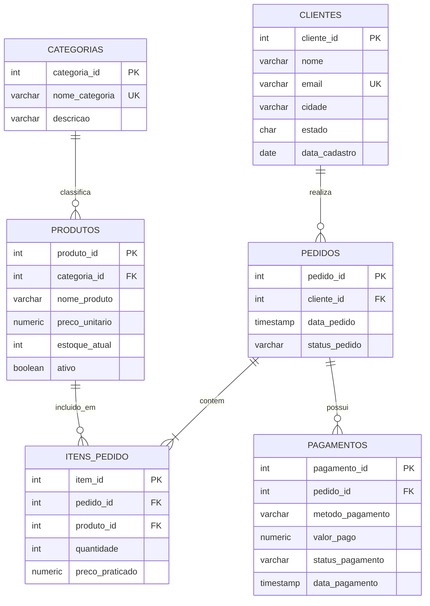

# 🛒 Projeto 01: Modelagem Relacional & Consultas Analíticas de E-Commerce

**Autor:** Victor Ramos  
**LinkedIn:** [victorramosbraga](https://www.linkedin.com/in/victorramosbraga) | **Email:** jsvramos@live.com  

## 📌 Visão Geral do Projeto

Este projeto demonstra a modelagem física e a extração de inteligência de negócios a partir de um banco de dados relacional de uma operação de comércio eletrônico (E-commerce).

O objetivo é simular um cenário real de mercado onde um analista ou engenheiro de dados precisa:
1. **Estruturar o banco de dados** com integridade referencial, constraints e índices de performance.
2. **Carregar dados de transações** preservando relacionamentos de cardinalidade (1:N e N:N).
3. **Responder a perguntas estratégicas da diretoria** utilizando técnicas avançadas de SQL (Window Functions, CTEs, Agrupamentos e Views).

---

## 📐 Diagrama Entidade-Relacionamento (DER)

Abaixo está o modelo de dados desenvolvido para o projeto:

---

## 💡 Técnicas e Conceitos de SQL Aplicados

- **DDL & Constraints:** Chaves primárias (`PRIMARY KEY`), estrangeiras (`FOREIGN KEY`), checagens condicionais (`CHECK`) e exclusão em cascata controlada (`ON DELETE CASCADE / RESTRICT`).
- **Otimização:** Criação de índices B-Tree (`CREATE INDEX`) para colunas de chaves estrangeiras e campos de filtro por data e status.
- **Window Functions:**
  - `LAG()`: Comparação de faturamento mês a mês (*Month-over-Month Growth*).
  - `DENSE_RANK()`: Ranking de produtos mais vendidos particionados por categoria (*PARTITION BY*).
  - `SUM(...) OVER (...)`: Cálculo de faturamento acumulado contínuo (*Running Total*).
- **Common Table Expressions (CTEs):** Modularização de queries analíticas para maior legibilidade e manutenção.
- **Views:** Criação de visão agregada (`vw_resumo_desempenho_mensal`) para consumo por ferramentas de Business Intelligence (Power BI, Tableau, Metabase).

---

## 📁 Estrutura dos Arquivos

| Arquivo | Descrição |
| :--- | :--- |
| [`01_schema_ddl.sql`](./01_schema_ddl.sql) | Script de criação de tabelas, constraints e índices. |
| [`02_seed_data.sql`](./02_seed_data.sql) | Script com carga inicial de dados consistentes. |
| [`03_business_queries.sql`](./03_business_queries.sql) | Consultas que resolvem os desafios de negócio propostos. |

---

## 🏃 Como Executar no DBeaver

1. Abra o **DBeaver** e conecte-se à sua instância do **PostgreSQL**.
2. Clique com botão direito na conexão `postgres` > **SQL Editor** > **Novo Editor SQL** (ou pressione `F3`).
3. Abra e execute os arquivos na seguinte sequência:
   - Execute o script `01_schema_ddl.sql` (pressione `Alt + X` para rodar o script inteiro).
   - Execute o script `02_seed_data.sql` (pressione `Alt + X`).
   - Abra o `03_business_queries.sql` e execute cada consulta individualmente (`Ctrl + Enter`) para analisar os resultados.
