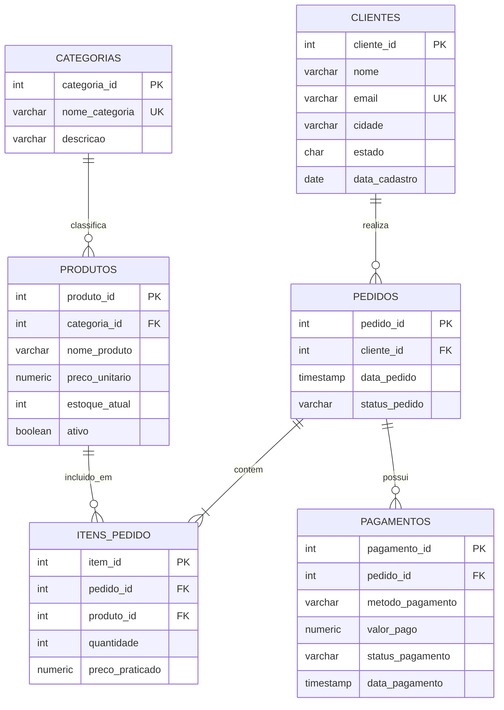

# Modelagem Relacional e Consultas Analiticas de E-Commerce

**Autor:** Victor Ramos  
**Formacao:** Jogos Digitais / Desenvolvimento de Games  
**Contato:** [LinkedIn](https://www.linkedin.com/in/victorramosbraga) | jsvramos@live.com  
**Tecnologias:** PostgreSQL, SQL DDL/DML, DBeaver, Git  

---

## Visao Geral

Projeto de modelagem fisica de dados e consultas analiticas simulando uma operacao de comercio eletronico. 

O foco deste projeto e demonstrar:
1. Estruturacao do banco com integridade referencial, constraints e indices de busca.
2. Carga controlada preservando relacionamentos de cardinalidade (1:N e N:N).
3. Consultas analiticas de suporte a tomada de decisao utilizando tecnicas de agregacao, Window Functions e Views.

---

## Diagrama Entidade-Relacionamento (DER)

---

## Tecnicas de SQL Aplicadas

* **DDL e Integridade:** Chaves primarias (`PRIMARY KEY`), estrangeiras (`FOREIGN KEY`), checagens condicionais (`CHECK`) e exclusao controlada (`ON DELETE CASCADE / RESTRICT`).
* **Indices de Busca:** Indices B-Tree para acelerar juncoes de chaves estrangeiras e filtros por data.
* **Window Functions:**
  * `LAG()`: Calculo de crescimento percentual mes a mes (MoM Growth).
  * `DENSE_RANK()`: Classificacao dos produtos mais vendidos por categoria (`PARTITION BY`).
  * `SUM(...) OVER (...)`: Calculo de faturamento acumulado continuo (Running Total).
* **CTEs e Views:** Modularizacao de consultas e criacao da view analitica `vw_resumo_desempenho_mensal`.

---

## Estrutura de Arquivos

| Arquivo | Descricao |
| :--- | :--- |
| [`01_schema_ddl.sql`](./01_schema_ddl.sql) | Criacao de tabelas, constraints e indices. |
| [`02_seed_data.sql`](./02_seed_data.sql) | Carga de dados consistente para testes. |
| [`03_business_queries.sql`](./03_business_queries.sql) | Consultas analiticas de negocio. |
| [`00_executar_tudo.sql`](./00_executar_tudo.sql) | Script unificado para execucao direta. |

---

## Como Executar no DBeaver

1. Conecte-se ao PostgreSQL no DBeaver.
2. Abra e execute os scripts na ordem numerica (`Alt + X`).
3. Execute as consultas analiticas em `03_business_queries.sql` (`Ctrl + Enter`).
