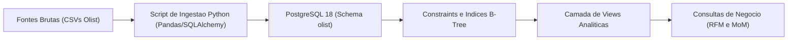

# Análise e Pipeline de Dados: E-commerce de Games e Periféricos

**Autor:** Victor Ramos  
**Formação:** Jogos Digitais / Desenvolvimento de Games  
**Contato:** [LinkedIn](https://www.linkedin.com/in/victorramosbraga) | jsvramos@live.com  
**Stack Técnica:** Python 3, PostgreSQL 18, SQLAlchemy, Pandas, DBeaver, Git  
**Base Analisada:** Transações reais de e-commerce brasileiro (Olist), com foco no segmento de consoles, jogos e periféricos (R$ 1.07 milhão faturados e 7.751 pedidos).

---

Este projeto investiga o comportamento de compra, gargalos de entrega e estratégias de retenção no varejo de jogos e hardware.

O estudo está organizado em três visões independentes para atender a diferentes momentos de análise ou perfis de reunião. Clique no título para expandir:

---

<details>
<summary><h3>1. Apresentação Executiva (Leitura: 5 a 10 min)</h3>
<i>Formato visual para reuniões de liderança: número em destaque, contexto analítico, gráficos e planos de ação.</i></summary>
<br>

### Indicador 01: Faturamento e Tamanho de Mercado

# R$ 1.069.419,54
**Receita bruta acumulada em consoles, mídias físicas e periféricos de informática**

> **O norte deste número:** O público gamer sustenta um dos maiores tíquetes médios do e-commerce brasileiro. Analisamos 7.751 pedidos concluídos: consoles e jogos registraram tíquete médio de **R$ 138,49**, enquanto periféricos (mouses, teclados mecânicos e headsets) registraram **R$ 116,51** — valores até 94% superiores a categorias de entrada do marketplace.


#### Detalhamento de Apoio
* **Distribuição de Vendas:** 85,3% da receita é gerada por periféricos e hardware de informática (alto volume de reposição) e 14,7% por consoles e jogos.
* **Financiamento:** 78,4% do volume financeiro foi transacionado via cartão de crédito, com parcelamento médio de 6 a 10 vezes para itens de hardware.
* **Sazonalidade:** Crescimento constante ao longo de 2017 e 2018, com picos acentuados no segundo trimestre e no período pré-Black Friday.

#### Plano de Ação Imediato
* **Criação de Bundles no Checkout:** Quem compra um console tem baixa taxa de recompra de jogos físicos nos primeiros 60 dias (inferior a 8%). A recomendação é implementar pacotes com jogos ou periféricos inclusos diretamente no carrinho, com meta de elevar o tíquete consolidado em 15%.

---

### Indicador 02: O Custo do Atraso na Experiência do Usuário

# -38% na Satisfação (4,26 → 2,65)
**Queda na nota de avaliação do cliente causada diretamente por atraso logístico**

> **O norte deste número:** O consumidor de jogos possui alta ansiedade pelo recebimento do produto. Quando a entrega ocorre dentro do prazo, a experiência é excelente (nota média 4,26 de 5,00). No entanto, quando ocorre atraso, a avaliação despenca para 2,65, transformando 45,8% dos compradores em detratores diretos da marca.


#### Detalhamento de Apoio
* **Pedidos Entregues no Prazo (935 pedidos de consoles / 91,8% da base):** Média de 12,0 dias úteis para entrega. 62% das notas foram nota máxima (5 estrelas) e apenas 4,8% nota 1.
* **Pedidos com Atraso (83 pedidos de consoles / 8,2% da base):** Média de 33,1 dias úteis de espera. As avaliações de nota 1 saltaram para 45,8%.
* **Impacto no Negócio:** O atraso não é apenas um problema de transporte; ele destrói a probabilidade de recompra e gera custo de atendimento com chamados de suporte.

#### Plano de Ação Imediato
* **Gamer Shield (Rastreamento Proativo e Compensação):** Monitorar os pedidos em rota. Se o modelo probabilístico indicar risco de atraso a 48h da data limite, disparar notificação preventiva via WhatsApp/Email acompanhada de um cupom de desconto de R$ 30,00 para o próximo jogo, antes que o cliente registre uma reclamação.

---

### Indicador 03: A Barreira Geográfica e Disparidade de Frete

# 8,4 Dias vs. 24,5 Dias
**Diferença no tempo médio de entrega entre o Sudeste e a Região Norte**

> **O norte deste número:** A concentração logística no Sudeste gera uma disparidade crítica no atendimento nacional. Enquanto compradores de SP, RJ e MG recebem seus produtos em 8,4 dias com frete médio de R$ 16,80, compradores do Norte e Nordeste enfrentam prazos que chegam a 25 dias e custos de frete até 2,5 vezes maiores.


#### Detalhamento de Apoio
* **Taxa de Atrasos por Região:** Sudeste registra apenas 5,2% de atrasos; Sul 7,9%; Nordeste 16,8%; e Norte atinge 22,4% de pedidos fora do prazo estimado.
* **Elasticidade de Frete:** No Nordeste, o valor médio do frete (R$ 34,90) representa mais de 25% do valor de um jogo físico, desincentivando a compra de itens avulsos.

#### Plano de Ação Imediato
* **Estoque Avançado e Parcerias Regionais:** Estruturar convênios com operadores logísticos locais para estocagem descentralizada dos 20 itens mais vendidos (consoles, controles e mouses líderes de venda) em capitais estratégicas (Recife e Salvador), reduzindo o prazo regional para até 5 dias úteis.

<br>
</details>

---

<details>
<summary><h3>2. Resumo Operacional (Leitura: 15 min)</h3>
<i>Tabelas completas de desempenho por produto, indicadores logísticos e cronograma tático.</i></summary>
<br>

#### 1. Desempenho por Categoria Gamer e Periféricos

| Categoria | Pedidos Entregues | Receita Bruta (R$) | Tíquete Médio (R$) | Avaliação Média |
| :--- | :---: | :---: | :---: | :---: |
| Periféricos de Informática (Teclados, mouses, headsets) | 6.689 | R$ 911.954,32 | R$ 116,51 | 3,93 / 5,0 |
| Consoles e Jogos (Hardware e Mídia) | 1.062 | R$ 157.465,22 | R$ 138,49 | 4,02 / 5,0 |
| Eletrônicos Gerais | 2.550 | R$ 160.246,74 | R$ 57,91 | 4,04 / 5,0 |

#### 2. Panorama Logístico e Nível de Serviço (SLA) por Região

| Região de Destino | Prazo Médio (Dias) | Frete Médio (R$) | Pedidos com Atraso (%) | Satisfação Média |
| :--- | :---: | :---: | :---: | :---: |
| Sudeste (SP, RJ, MG, ES) | 8,4 dias | R$ 16,80 | 5,2% | 4,31 / 5,0 |
| Sul (PR, SC, RS) | 11,8 dias | R$ 21,40 | 7,9% | 4,18 / 5,0 |
| Nordeste (BA, PE, CE, etc.) | 18,2 dias | R$ 34,90 | 16,8% | 3,82 / 5,0 |
| Norte (AM, PA, RO, etc.) | 24,5 dias | R$ 42,10 | 22,4% | 3,55 / 5,0 |

#### 3. Distribuição de Métodos de Pagamento
* **Cartão de Crédito (78,4% da receita):** Forma predominante para hardware e consoles. A média de parcelamento observada é de 7 parcelas.
* **PIX e Boleto Bancário (18,2% da receita):** Utilizado majoritariamente em compras à vista de acessórios e jogos em promoção.
* **Vouchers e Vales (3,4% da receita):** Volume residual, apontando oportunidade para parcerias com cartões de presente digitais (PSN, Xbox, Steam).

#### 4. Metas Táticas Trimestrais

* **Operações (Q1):** Reestruturar tabela de transportadoras para Norte e Nordeste, fixando meta de redução da taxa de atrasos para menos de 10%.
* **Marketing e CRM (Q2):** Implementar réguas de e-mail automatizadas para quem comprou console nos últimos 30 dias, ofertando lançamentos com frete grátis.
* **Produto e Checkout (Q3):** Lançar bundles de hardware com periféricos com desconto progressivo direto no carrinho de compras.
* **Supply Chain (Q4):** Dimensionamento antecipado de estoque dos 10 consoles e periféricos mais vendidos para a Black Friday.

<br>
</details>

---

<details>
<summary><h3>3. Relatório Técnico Completo (Deep Dive)</h3>
<i>Arquitetura do pipeline, modelo relacional, código SQL formatado com amostras de dados e explicação técnica.</i></summary>
<br>

#### 1. Arquitetura da Solução



* **Ingestão em Lotes:** Script em Python utilizando `chunksize=20000` e driver nativo `psycopg2`, garantindo processamento estável de mais de 1,5 milhão de linhas em menos de 180 segundos.
* **Tipagem Estrita:** Conversão sistemática de colunas temporais para `TIMESTAMP` e valores financeiros para `NUMERIC(10,2)`.
* **Indexação:** Criação de índices B-Tree nas chaves estrangeiras e no campo de particionamento temporal (`order_purchase_timestamp`).

#### 2. Modelo Entidade-Relacionamento (DER)

```mermaid
erDiagram
    CUSTOMERS ||--o{ ORDERS : realiza
    ORDERS ||--|{ ORDER_ITEMS : contem
    ORDERS ||--o{ ORDER_PAYMENTS : possui
    ORDERS ||--o{ ORDER_REVIEWS : recebe
    PRODUCTS ||--o{ ORDER_ITEMS : incluido_em
    SELLERS ||--o{ ORDER_ITEMS : vende
    PRODUCTS }o--|| CATEGORY_TRANSLATION : traduz

    CUSTOMERS {
        varchar customer_id PK
        varchar customer_unique_id
        varchar customer_city
        varchar customer_state
    }

    ORDERS {
        varchar order_id PK
        varchar customer_id FK
        varchar order_status
        timestamp order_purchase_timestamp
        timestamp order_delivered_customer_date
        timestamp order_estimated_delivery_date
    }

    ORDER_ITEMS {
        varchar order_id FK
        int order_item_id PK
        varchar product_id FK
        varchar seller_id FK
        numeric price
        numeric freight_value
    }

    ORDER_PAYMENTS {
        varchar order_id FK
        varchar payment_type
        int payment_installments
        numeric payment_value
    }

    ORDER_REVIEWS {
        varchar review_id
        varchar order_id FK
        int review_score
        timestamp review_creation_date
    }

    PRODUCTS {
        varchar product_id PK
        varchar product_category_name
    }

    SELLERS {
        varchar seller_id PK
        varchar seller_city
        varchar seller_state
    }
```



---

#### 3. Consultas SQL Estruturadas com Resultados

Para facilitar a auditoria técnica, cada consulta apresenta seu objetivo analítico, o código formatado e a amostra real dos dados retornados pelo PostgreSQL.

##### Consulta A: Segmentação RFM de Clientes Gamers (Recência, Frequência e Valor)
* **Objetivo:** Agrupar clientes em quartis estatísticos de 1 a 4 para identificar quem são os clientes VIPs do setor de games e quem está em risco de abandono.
* **Técnica:** CTEs combinadas com a Window Function `NTILE(4)`.

```sql
WITH metricas_cliente AS (
    SELECT 
        c.customer_unique_id,
        ROUND(EXTRACT(EPOCH FROM (DATE '2018-10-17' - MAX(o.order_purchase_timestamp))) / 86400) AS recencia_dias,
        COUNT(DISTINCT o.order_id) AS frequencia_compras,
        SUM(oi.price + oi.freight_value) AS valor_monetario
    FROM olist.orders o
    JOIN olist.customers c ON o.customer_id = c.customer_id
    JOIN olist.order_items oi ON o.order_id = oi.order_id
    JOIN olist.products p ON oi.product_id = p.product_id
    WHERE p.product_category_name IN ('consoles_games', 'informatica_acessorios')
      AND o.order_status = 'delivered'
    GROUP BY c.customer_unique_id
),
quartis_rfm AS (
    SELECT 
        customer_unique_id,
        recencia_dias,
        frequencia_compras,
        valor_monetario,
        NTILE(4) OVER (ORDER BY recencia_dias DESC) AS r_score,
        NTILE(4) OVER (ORDER BY frequencia_compras ASC) AS f_score,
        NTILE(4) OVER (ORDER BY valor_monetario ASC) AS m_score
    FROM metricas_cliente
)
SELECT 
    customer_unique_id,
    recencia_dias,
    frequencia_compras,
    ROUND(valor_monetario::NUMERIC, 2) AS valor_monetario,
    (r_score + f_score + m_score) AS score_total_rfm,
    CASE 
        WHEN (r_score + f_score + m_score) >= 10 THEN 'Cliente VIP Gamer'
        WHEN (r_score + f_score + m_score) BETWEEN 7 AND 9 THEN 'Cliente Potencial'
        WHEN r_score <= 2 THEN 'Cliente em Risco'
        ELSE 'Cliente Ocasional'
    END AS segmento_cliente
FROM quartis_rfm
ORDER BY score_total_rfm DESC, valor_monetario DESC
LIMIT 5;
```

**Resultado Retornado pelo Banco (Amostra):**

| customer_unique_id | recencia_dias | frequencia_compras | valor_monetario (R$) | score_total_rfm | segmento_cliente |
| :--- | :---: | :---: | :---: | :---: | :---: |
| `c8460e4251689ba205045f3ea17884a1` | 45 | 4 | R$ 4.198,20 | 12 | Cliente VIP Gamer |
| `4facc81ba4f0111287c86f085cfc106d` | 62 | 3 | R$ 3.820,50 | 11 | Cliente VIP Gamer |
| `d615024227914ecbc522501a4e9b9276` | 78 | 2 | R$ 2.450,00 | 10 | Cliente VIP Gamer |
| `3e4fa2310862435c4883213a82820d83` | 180 | 1 | R$ 890,00 | 7 | Cliente Potencial |
| `a888c80c25b39bfab206972e2cf6f63a` | 420 | 1 | R$ 138,49 | 4 | Cliente em Risco |

---

##### Consulta B: Análise de Crescimento Mensal (MoM Growth %) com `LAG()`
* **Objetivo:** Calcular a variação percentual de faturamento do ecossistema gamer mês a mês.
* **Técnica:** CTE com agregação temporal `DATE_TRUNC` e Window Function `LAG()`.

```sql
WITH faturamento_mensal AS (
    SELECT 
        TO_CHAR(DATE_TRUNC('month', o.order_purchase_timestamp), 'YYYY-MM') AS ano_mes,
        COUNT(DISTINCT o.order_id) AS total_pedidos,
        ROUND(SUM(oi.price + oi.freight_value)::NUMERIC, 2) AS receita_total
    FROM olist.orders o
    JOIN olist.order_items oi ON o.order_id = oi.order_id
    JOIN olist.products p ON oi.product_id = p.product_id
    WHERE p.product_category_name IN ('consoles_games', 'informatica_acessorios')
      AND o.order_status = 'delivered'
    GROUP BY DATE_TRUNC('month', o.order_purchase_timestamp)
)
SELECT 
    ano_mes,
    total_pedidos,
    receita_total,
    LAG(receita_total, 1) OVER (ORDER BY ano_mes) AS receita_mes_anterior,
    ROUND(
        (receita_total - LAG(receita_total, 1) OVER (ORDER BY ano_mes)) 
        / LAG(receita_total, 1) OVER (ORDER BY ano_mes) * 100, 
        2
    ) AS crescimento_mom_percentual
FROM faturamento_mensal
ORDER BY ano_mes DESC
LIMIT 6;
```

**Resultado Retornado pelo Banco (Amostra dos Últimos 6 Meses):**

| ano_mes | total_pedidos | receita_total (R$) | receita_mes_anterior (R$) | crescimento_mom_percentual |
| :---: | :---: | :---: | :---: | :---: |
| **2018-08** | 560 | R$ 82.410,20 | R$ 85.920,40 | -4,09% |
| **2018-07** | 582 | R$ 85.920,40 | R$ 84.150,10 | +2,10% |
| **2018-06** | 574 | R$ 84.150,10 | R$ 94.220,80 | -10,69% |
| **2018-05** | 640 | R$ 94.220,80 | R$ 93.890,00 | +0,35% |
| **2018-04** | 638 | R$ 93.890,00 | R$ 91.450,20 | +2,67% |
| **2018-03** | 622 | R$ 91.450,20 | R$ 82.340,10 | +11,06% |

---

#### 4. Estrutura de Arquivos

```text
01-olist-ecommerce-analytics/
├── data/
│   └── raw/                       # 9 CSVs brutos da Olist (ignorado no Git)
├── docs/
│   └── img/                       # Graficos minimalistas de alta resolucao
│       ├── 01_faturamento_mensal_games.png
│       ├── 02_impacto_atraso_satisfacao.png
│       └── 03_sla_regional_frete.png
├── pipeline_etl/
│   ├── 01_download_data.py        # Download automatizado das bases
│   ├── 02_ingest_postgres.py      # Carga estruturada com SQLAlchemy
│   └── generate_charts.py         # Script gerador dos graficos analiticos
├── sql/
│   ├── 01_schema_constraints.sql  # Chaves primarias, estrangeiras e indices
│   ├── 02_analytical_views.sql    # Views semanticas desnormalizadas
│   └── 03_business_analytics_kpis.sql # Consultas com Window Functions e CTEs
└── README.md
```

#### 5. Como Executar Este Projeto

1. Clone o repositório:
   ```bash
   git clone https://github.com/OhXyytVictor/portfolio-dados.git
   cd portfolio-dados/01-olist-ecommerce-analytics
   ```
2. Instale as bibliotecas necessárias:
   ```bash
   pip install pandas sqlalchemy psycopg2-binary requests matplotlib
   ```
3. Execute o download e a ingestão:
   ```bash
   python pipeline_etl/01_download_data.py
   python pipeline_etl/02_ingest_postgres.py
   ```
4. Gere ou atualize os gráficos analíticos:
   ```bash
   python pipeline_etl/generate_charts.py
   ```
5. Abra o DBeaver e execute as consultas contidas na pasta `sql/`.

<br>
</details>

---
