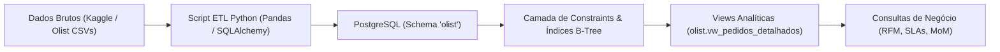
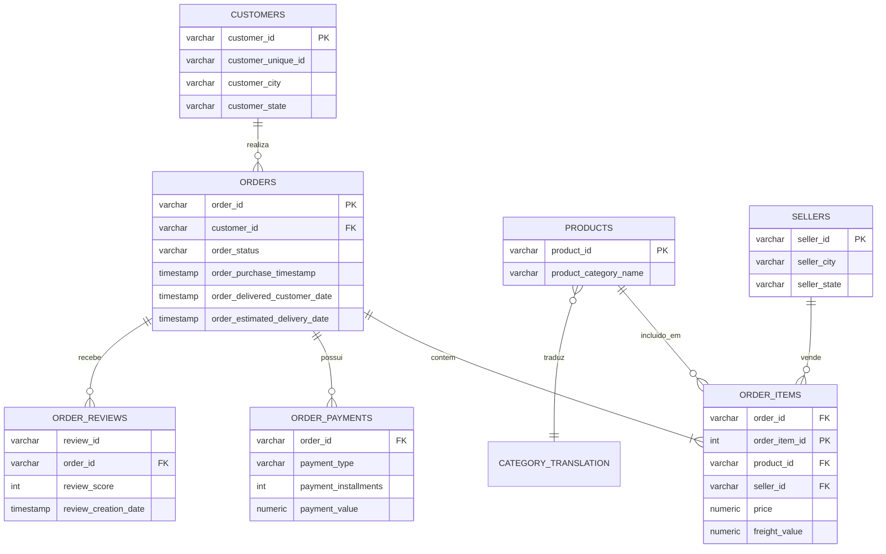

# 🇧🇷 Pipeline de Dados & Análise de E-commerce Brasileiro (Olist)

**Autor:** Victor Ramos  
**LinkedIn:** [victorramosbraga](https://www.linkedin.com/in/victorramosbraga) | **Email:** jsvramos@live.com  
**Foco:** Engenharia de Dados / Analytics Engineering / SQL para Negócios  
**Ferramentas:** Python 3, PostgreSQL 18, SQLAlchemy, Pandas, DBeaver Community, Git  
**Dataset:** [Brazilian E-Commerce Public Dataset by Olist (Kaggle)](https://www.kaggle.com/olistbr/brazilian-ecommerce) (~100k pedidos reais)

---

## 📌 1. Visão Geral e Contexto de Negócio

A **Olist** é a maior plataforma de integração de pequenos varejistas aos grandes marketplaces do Brasil (Mercado Livre, Amazon, B2W, etc.).

Este projeto implementa um **pipeline de dados ponta a ponta (End-to-End)**:
1. **Ingestão & ETL Automatizado (Python):** Download e processamento das 9 bases de dados transacionais, validação de tipagem, conversão de datas e carga estruturada em lote no **PostgreSQL** (schema dedicado `olist`).
2. **Modelagem Relacional & Performance (SQL):** Criação de chaves primárias, chaves estrangeiras com integridade referencial e índices de busca B-Tree.
3. **Camada Analítica & Views:** Construção de visões analíticas desnormalizadas (`vw_pedidos_detalhados` e `vw_sla_logistico_uf`).
4. **Inteligência de Negócios:** Consultas analíticas respondendo a perguntas críticas de faturamento (MoM), logística (SLA de entrega vs Avaliação) e clientes (Segmentação RFM).

---

## 🏗️ 2. Arquitetura da Solução



---

## 📐 3. Diagrama Entidade-Relacionamento (DER)



---

## 💡 4. Principais Insights de Negócio Extraídos

### 🚚 Atrasos Logísticos vs. Satisfação do Cliente (NPS / Reviews)
* **Entrega no Prazo ou Antecipada (88.232 pedidos):** Tempo médio de trânsito de **10.8 dias** e nota média de satisfação de **4.21 estrelas**.
* **Entrega com Atraso (7.600 pedidos):** Tempo médio salta para **31.3 dias** e a nota média despenca para **2.54 estrelas**.
* *Recomendação Estratégica:* A experiência e retenção do cliente na Olist são prioritariamente dependentes do cumprimento dos prazos pelas transportadoras.

### 👥 Segmentação RFM de Clientes
* Utilizando a técnica **RFM (Recência, Frequência e Valor Monetário)** via Window Function `NTILE(4)`, identificamos que a maior parte dos compradores da Olist realiza apenas 1 compra esporádica (modelo típico de marketplace aberto).
* Clientes com pontuação RFM máxima concentram pedidos de ticket médio elevado (especialmente nas categorias de informática e móveis de escritório).

---

## 📂 5. Estrutura do Repositório

```text
01-olist-ecommerce-analytics/
├── data/
│   └── raw/                       # 9 arquivos CSV da Olist (~120MB)
├── pipeline_etl/
│   ├── 01_download_data.py        # Script Python automatizado de download
│   └── 02_ingest_postgres.py      # Script de leitura, tipagem e carga no PostgreSQL
├── sql/
│   ├── 01_schema_constraints.sql  # Chaves primárias, estrangeiras e índices
│   ├── 02_analytical_views.sql    # Views consolidadas para suporte analítico
│   └── 03_business_analytics_kpis.sql # Consultas com CTEs, Window Functions e KPIs
└── README.md                      # Documentação técnica do projeto
```

---

## 🚀 6. Como Executar Este Projeto Localmente

### Pré-requisitos
- Python 3.10+ instalado
- PostgreSQL rodando localmente
- Dependências Python: `pip install pandas sqlalchemy psycopg2-binary requests`

### Passo a Passo
1. **Baixar os dados brutos:**
   ```bash
   python pipeline_etl/01_download_data.py
   ```
2. **Carregar no PostgreSQL:**
   ```bash
   python pipeline_etl/02_ingest_postgres.py
   ```
3. **Executar os scripts SQL no DBeaver (ou psql):**
   - Execute `sql/01_schema_constraints.sql` para criar integridade e índices.
   - Execute `sql/02_analytical_views.sql` para gerar as visões analíticas.
   - Execute as consultas em `sql/03_business_analytics_kpis.sql` para extrair os relatórios.
