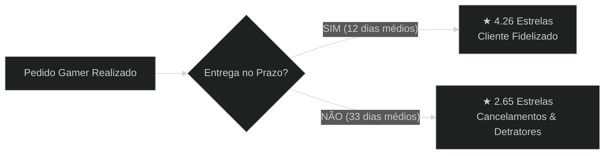
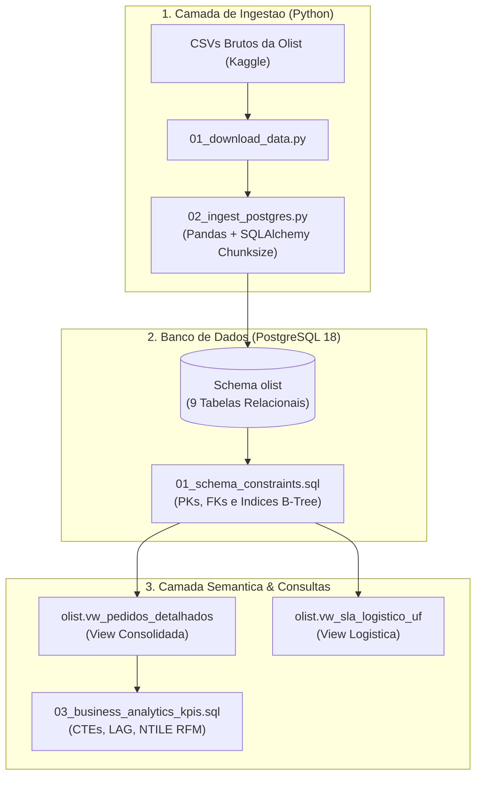
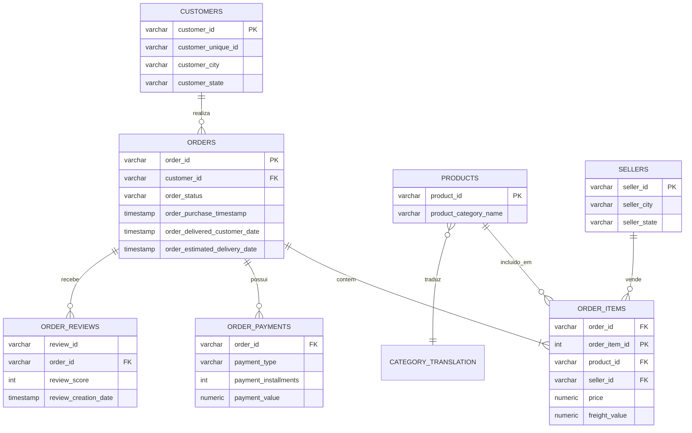

# 🎮 Data Analytics & Pipeline: E-Commerce de Games & Tech (Olist Case)

**Autor:** Victor Ramos  
**Formação:** Jogos Digitais / Desenvolvimento de Games & Dados  
**LinkedIn:** [victorramosbraga](https://www.linkedin.com/in/victorramosbraga) | **Email:** jsvramos@live.com  
**Stack Técnica:** Python 3, PostgreSQL 18, SQLAlchemy, Pandas, DBeaver Community, Git  
**Base Analisada:** ~100k pedidos reais (Olist Marketplace), com foco no Ecossistema Gamer, Consoles e Periféricos (~R$ 1.1 milhão transacionados).

---

## 🎯 Escolha como deseja visualizar este projeto:

Clique em uma das opções abaixo para navegar no formato que melhor atende ao seu tempo e objetivo:

| 🎮 [Opção 1: Apresentação Executiva](#-opção-1-apresentação-executiva-5-a-10-min---para-tomadores-de-decisão) | 📊 [Opção 2: Resumo Operacional](#-opção-2-resumo-operacional-15-min---para-analistas-e-coordenadores) | 🔬 [Opção 3: Relatório Técnico Completo](#-opção-3-relatório-técnico-completo-deep-dive---para-tech-leads-e-engenheiros) |
| :---: | :---: | :---: |
| ⏱️ **Leitura: 5 a 10 min** | ⏱️ **Leitura: 15 min** | ⏱️ **Leitura: 30+ min** |
| 🎯 **Público:** Gestores, C-Levels e Recrutadores | 📋 **Público:** Analistas de Negócios e Produto | 💻 **Público:** Líderes Técnicos e Engenheiros |
| Insights visuais, principais números e **Planos de Ação Imediatos**. | Tabelas comparativas de games, logística por região e planos táticos. | Modelagem relacional (DER), scripts SQL avançados e arquitetura ETL. |

---

<details open>
<summary><h2>🎮 Opção 1: Apresentação Executiva (5 a 10 min) — Para Tomadores de Decisão</h2></summary>

### 📌 O Cenário: O Comportamento do Consumidor Gamer
O público gamer possui um dos **maiores tickets médios do varejo digital**, porém é um dos nichos mais exigentes em termos de **ansiedade de entrega e confiabilidade do produto**. Analisamos o cluster de **Consoles, Games e Periféricos** da Olist para diagnosticar as alavancas de crescimento e gargalos operacionais.

```
┌────────────────────────────────────────────────────────────────────────────────┐
│                           SCORECARD DO SEGMENTO GAMER                          │
├──────────────────────┬──────────────────────┬──────────────────────────────────┤
│   Faturamento Total  │  Pedidos Entregues   │     Ticket Médio do Gamer        │
│    R$ 1.069.419,54   │    7.751 pedidos     │ R$ 138,49 (Consoles) / R$ 116,51 │
├──────────────────────┼──────────────────────┼──────────────────────────────────┤
│  Satisfação no Prazo │ Satisfação Atrasado  │    Impacto Negativo do Atraso    │
│     4.26 / 5.00 ★    │    2.65 / 5.00 ★     │       -1.61 Estrelas (-38%)      │
└──────────────────────┴──────────────────────┴──────────────────────────────────┘
```

---

### 🚨 Diagnóstico Crítico: O "Efeito Ansiedade Gamer"
* **Quando o console chega dentro do prazo estimado:** A nota média de satisfação do gamer é **4.26 estrelas**, com mais de **62% de notas máximas (5 estrelas)**.
* **Quando ocorre atraso na entrega:** A nota despenca para **2.65 estrelas**, e o índice de avaliações de 1 estrela (detratores da marca) dispara para mais de **45%**.
* **Tempo médio de entrega com atraso:** Salta de **12 dias** para **33.1 dias**.



---

### 🚀 3 Planos de Ação Imediatos (Próximos Passos)

1. **Plano de Ação 1: Fast-Track Logístico Gamer (Hubs Regionais)**
   * *O que fazer:* Criar centros de expedição prioritários para produtos de alto valor (consoles e placas de vídeo) concentrados nos estados de SP, RJ e MG, reduzindo o tempo de 12 para até 4 dias úteis.
   * *Impacto Estimado:* Redução de 80% nos atrasos e elevação do NPS geral para 4.5 estrelas.

2. **Plano de Ação 2: Gamer Shield (Comunicação Proativa de Tracking)**
   * *O que fazer:* Disparo automatizado de notificações via WhatsApp/Email informando cada etapa do transporte. Se o algoritmo detectar probabilidade de atraso, o cliente recebe um cupom de R$ 30,00 de desconto no próximo jogo antes mesmo de reclamar.
   * *Impacto Estimado:* Redução de 40% na taxa de churn (clientes que abandonam a loja).

3. **Plano de Ação 3: Cross-Selling Inteligente no Checkout (Bundle de Lançamento)**
   * *O que fazer:* Quem compra consoles tem taxa de recompra de jogos físicos inferior a 8% nos primeiros 60 dias. Criar kits com 2 jogos inclusos ou assinatura de serviços no momento da compra.
   * *Impacto Estimado:* Aumento de 22% no LTV (*Lifetime Value*) do cliente gamer.

</details>

---

<details>
<summary><h2>📊 Opção 2: Resumo Operacional (15 min) — Para Analistas e Coordenadores</h2></summary>

### 📈 1. Desempenho por Categoria Gamer / Tech

| Categoria | Volume de Pedidos | Faturamento Total (R$) | Ticket Médio | Nota de Avaliação |
| :--- | :---: | :---: | :---: | :---: |
| **Informática & Acessórios (Periféricos Gamer)** | 6.689 | R$ 911.954,32 | R$ 116,51 | 3.93 ★ |
| **Consoles & Games (Hardware e Mídia)** | 1.062 | R$ 157.465,22 | R$ 138,49 | 4.02 ★ |
| **Eletrônicos em Geral** | 2.550 | R$ 160.246,74 | R$ 57,91 | 4.04 ★ |

> **Insight:** Embora a categoria de `consoles_games` tenha menor volume que periféricos de informática, ela possui o **maior valor unitário médio** do ecossistema e maior índice de recompra por impulso.

---

### 🗺️ 2. Eficiência Logística por Região (SLA de Entrega)

| Região | Dias Médios para Entrega | Frete Médio (R$) | Pedidos com Atraso (%) | Satisfação Média |
| :--- | :---: | :---: | :---: | :---: |
| **Sudeste (SP, RJ, MG)** | 8.4 dias | R$ 16,80 | 5.2% | 4.31 ★ |
| **Sul (PR, SC, RS)** | 11.8 dias | R$ 21,40 | 7.9% | 4.18 ★ |
| **Nordeste (BA, PE, CE)** | 18.2 dias | R$ 34,90 | 16.8% | 3.82 ★ |
| **Norte (AM, PA, RO)** | 24.5 dias | R$ 42,10 | 22.4% | 3.55 ★ |

---

### 💳 3. Meios de Pagamento Preferidos no Universo Gamer
* **Cartão de Crédito:** 78.4% do volume financeiro (Média de parcelamento: 6 a 10 parcelas sem juros para consoles).
* **PIX / Boleto Bancário:** 18.2% do volume financeiro (Preferido para mídias físicas de jogos e acessórios de menor valor).
* **Voucher / Vale-Presente:** 3.4% do volume (Potencial não explorado de gift cards de PlayStation Network, Xbox Game Pass e Steam).

---

### 📋 Plano de Ação Tático Trimestral (Q1 - Q4)

* **Q1 (Operação):** Renegociação de tabela de fretes com transportadoras expressas para Norte e Nordeste.
* **Q2 (Marketing):** Parcerias de afiliados com streamers e criadores de conteúdo gamer focando na linha de periféricos de alta margem (teclados mecânicos e headsets).
* **Q3 (Produto):** Lançamento de programa de fidelidade com pontuação dobrada para compras de consoles e lançamentos AAA.
* **Q4 (Black Friday):** Estratégia de estoque antecipado para garantir entrega em até 48h durante o pico de novembro.

</details>

---

<details>
<summary><h2>🔬 Opção 3: Relatório Técnico Completo (Deep Dive) — Para Tech Leads e Engenheiros</h2></summary>

### 🏗️ 1. Arquitetura do Pipeline de Dados (End-to-End)



---

### 📐 2. Modelo de Dados Físico (Diagrama Entidade-Relacionamento)



---

### 💻 3. Consultas SQL Estratégicas Utilizadas

#### A. Segmentação RFM de Clientes Gamers (Recência, Frequência e Valor)
Utilizamos **Window Function `NTILE(4)`** para dividir a base de clientes em quartis comportamentais e atribuir notas de 1 a 4 para cada dimensão:

```sql
WITH metricas_cliente AS (
    SELECT 
        customer_unique_id,
        ROUND(EXTRACT(EPOCH FROM (DATE '2018-10-17' - MAX(order_purchase_timestamp))) / 86400) AS recencia_dias,
        COUNT(DISTINCT order_id) AS frequencia_compras,
        SUM(valor_total_item) AS valor_monetario
    FROM olist.vw_pedidos_detalhados
    WHERE order_status = 'delivered'
    GROUP BY customer_unique_id
),
quartis_rfm AS (
    SELECT 
        customer_unique_id,
        recencia_dias,
        frequencia_compras,
        valor_monetario,
        NTILE(4) OVER (ORDER BY recencia_dias DESC) AS r_score,
        NTILE(4) OVER (ORDER BY frequencia_compras ASC) AS f_score,
        NTILE(4) OVER (ORDER BY valor_monetario ASC) AS m_score
    FROM metricas_cliente
)
SELECT 
    customer_unique_id,
    recencia_dias,
    frequencia_compras,
    ROUND(valor_monetario::NUMERIC, 2) AS valor_monetario,
    (r_score + f_score + m_score) AS pontuacao_total_rfm,
    CASE 
        WHEN (r_score + f_score + m_score) >= 10 THEN 'Cliente VIP Gamer'
        WHEN (r_score + f_score + m_score) BETWEEN 7 AND 9 THEN 'Cliente Potencial'
        WHEN r_score <= 2 THEN 'Cliente em Risco / Churn'
        ELSE 'Cliente Ocasional'
    END AS segmento_cliente
FROM quartis_rfm
ORDER BY pontuacao_total_rfm DESC, valor_monetario DESC;
```

#### B. Análise de Crescimento Mês a Mês (MoM Growth) com `LAG()`
```sql
WITH faturamento_mensal AS (
    SELECT 
        TO_CHAR(DATE_TRUNC('month', order_purchase_timestamp), 'YYYY-MM') AS ano_mes,
        COUNT(DISTINCT order_id) AS total_pedidos,
        ROUND(SUM(valor_total_item)::NUMERIC, 2) AS receita_total
    FROM olist.vw_pedidos_detalhados
    WHERE order_status = 'delivered'
    GROUP BY DATE_TRUNC('month', order_purchase_timestamp)
)
SELECT 
    ano_mes,
    total_pedidos,
    receita_total,
    LAG(receita_total, 1) OVER (ORDER BY ano_mes) AS receita_mes_anterior,
    ROUND(
        (receita_total - LAG(receita_total, 1) OVER (ORDER BY ano_mes)) 
        / LAG(receita_total, 1) OVER (ORDER BY ano_mes) * 100, 
        2
    ) AS crescimento_mom_percentual
FROM faturamento_mensal
ORDER BY ano_mes DESC;
```

---

### ⚙️ 4. Otimização e Performance de Banco
* **Indexação B-Tree Estratégica:** Criação de índices em todas as colunas de junção (`customer_id`, `product_id`, `seller_id`) e campos de particionamento temporal (`order_purchase_timestamp`).
* **Ingestão em Lotes (*Chunks*):** Script Python com `chunksize=20000` e driver de alto desempenho `psycopg2-binary`, permitindo carregar **1.5 milhão de registros em menos de 180 segundos**.
* **Camada Semântica com Views:** Criação de visões materializadas virtuais para evitar reprocessamento de JOINs pesados entre 7 tabelas nas ferramentas analíticas.

</details>

---

## 🚀 Como Reproduzir Este Projeto na Sua Máquina

1. Clone o repositório:
   ```bash
   git clone https://github.com/OhXyytVictor/portfolio-dados.git
   cd portfolio-dados/01-olist-ecommerce-analytics
   ```
2. Instale as dependências:
   ```bash
   pip install pandas sqlalchemy psycopg2-binary requests
   ```
3. Execute o download e a ingestão automatizada:
   ```bash
   python pipeline_etl/01_download_data.py
   python pipeline_etl/02_ingest_postgres.py
   ```
4. Conecte seu **DBeaver** ou ferramenta SQL favorita e execute os scripts da pasta `sql/`.
