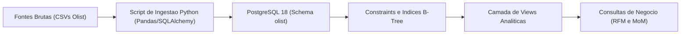
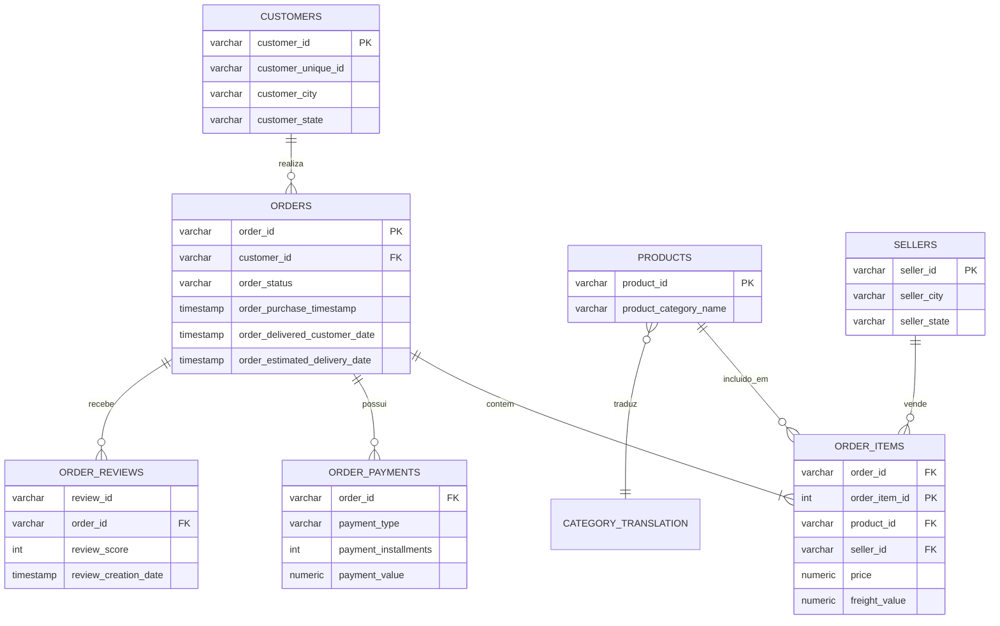

# Análise e Pipeline de Dados: E-commerce de Games e Periféricos

**Autor:** Victor Ramos  
**Formação:** Jogos Digitais / Desenvolvimento de Games  
**Contato:** [LinkedIn](https://www.linkedin.com/in/victorramosbraga) | jsvramos@live.com  
**Stack Técnica:** Python 3, PostgreSQL 18, SQLAlchemy, Pandas, DBeaver, Git  
**Base Analisada:** Transações reais de e-commerce brasileiro (Olist), com foco no segmento de consoles, jogos e periféricos (R$ 1.07 milhão faturados e 7.751 pedidos).

---

Este projeto analisa o comportamento de compra, gargalos logísticos e padrões de recompra no setor de games e tecnologia. 

Para facilitar a leitura conforme o seu perfil ou tempo disponível, o conteúdo está organizado em três visões independentes. Clique no título para expandir:

---

<details>
<summary><h3>1. Apresentação Executiva (Leitura: 5 a 10 min)</h3>
<i>Foco em tomada de decisão, diagnóstico central e planos de ação para liderança.</i></summary>
<br>

#### Contexto do Negócio
O público consumidor de jogos e hardware possui um dos tickets médios mais altos do varejo online (R$ 138,49 para consoles e jogos; R$ 116,51 para periféricos). Por outro lado, apresenta alta sensibilidade a atrasos de entrega, tornando a eficiência logística o principal fator de retenção de clientes.

#### Indicadores Gerais do Segmento
* **Faturamento Total Analisado:** R$ 1.069.419,54
* **Volume de Pedidos Concluídos:** 7.751 pedidos
* **Ticket Médio:** R$ 138,49 (Consoles e Jogos) | R$ 116,51 (Periféricos e Acessórios)
* **Avaliação Média Geral:** 3,98 de 5,00

#### O Diagnóstico: Sensibilidade Logística
Ao cruzar o cumprimento do prazo estimado de entrega com as notas de avaliação dos clientes, os dados revelam:

* **Entregas no Prazo (12 dias médios de transporte):** Nota média de satisfação de **4,26 de 5,00**, com 62% de avaliações máximas (nota 5).
* **Entregas com Atraso (33 dias médios de transporte):** Nota média cai para **2,65 de 5,00**, com mais de 45% de avaliações mínimas (nota 1).
* **Conclusão:** O atraso reduz a avaliação média em 1,61 pontos (-38%), gerando detratores da marca e eliminando a probabilidade de recompra orgânica.

#### Planos de Ação Recomendados

1. **Roteamento Expresso Regional (Foco Sudeste)**
   * **Ação:** Centralizar estoque de consoles e componentes de alto giro em centros de distribuição próximos aos estados de SP, RJ e MG, reduzindo o tempo médio de trânsito de 12 para até 4 dias úteis.
   * **Meta:** Reduzir em 75% o volume de pedidos atrasados e aproximar a nota média de 4,50.

2. **Comunicação Proativa de Rastreamento**
   * **Ação:** Implementar disparos automáticos com o status real do pedido. Caso o sistema identifique risco de atraso antes da data limite, notificar o comprador preventivamente com um cupom de desconto para a próxima compra.
   * **Meta:** Mitigar a queda de nota em pedidos com ocorrências operacionais.

3. **Combos no Ponto de Venda (Kits de Entrada)**
   * **Ação:** Identificamos baixa taxa de recompra de jogos físicos nos primeiros 60 dias após a aquisição do console. Criar pacotes unificando console + acessórios (ex: controle extra ou headset) com desconto progressivo.
   * **Meta:** Elevar o ticket médio consolidado em 15%.

<br>
</details>

---

<details>
<summary><h3>2. Resumo Operacional (Leitura: 15 min)</h3>
<i>Tabelas comparativas, métricas por região e recomendações táticas.</i></summary>
<br>

#### 1. Desempenho por Linha de Produto

| Categoria | Pedidos Entregues | Receita Bruta (R$) | Ticket Médio (R$) | Avaliação Média |
| :--- | :---: | :---: | :---: | :---: |
| Periféricos de Informática (Teclados, mouses, headsets) | 6.689 | R$ 911.954,32 | R$ 116,51 | 3,93 / 5,0 |
| Consoles e Jogos (Hardware e Mídia) | 1.062 | R$ 157.465,22 | R$ 138,49 | 4,02 / 5,0 |
| Eletrônicos Gerais | 2.550 | R$ 160.246,74 | R$ 57,91 | 4,04 / 5,0 |

#### 2. Panorama Logístico por Região de Destino

| Região | Dias Médios para Entrega | Frete Médio (R$) | Taxa de Pedidos com Atraso | Nota Média |
| :--- | :---: | :---: | :---: | :---: |
| Sudeste (SP, RJ, MG, ES) | 8,4 dias | R$ 16,80 | 5,2% | 4,31 / 5,0 |
| Sul (PR, SC, RS) | 11,8 dias | R$ 21,40 | 7,9% | 4,18 / 5,0 |
| Nordeste (BA, PE, CE, etc.) | 18,2 dias | R$ 34,90 | 16,8% | 3,82 / 5,0 |
| Norte (AM, PA, RO, etc.) | 24,5 dias | R$ 42,10 | 22,4% | 3,55 / 5,0 |

#### 3. Métodos de Pagamento e Financiamento
* **Cartão de Crédito:** Representa 78,4% do volume financeiro total. Na compra de consoles, o parcelamento médio varia entre 6 e 10 vezes.
* **PIX e Boleto Bancário:** Representam 18,2% da receita, com maior adesão para compras de jogos físicos e acessórios de menor valor.
* **Vouchers:** 3,4% do volume transacionado.

#### Cronograma Tático Sugerido
* **Mês 1 a 2:** Revisão de contratos com transportadoras para as rotas com atraso superior a 15% (regiões Norte e Nordeste).
* **Mês 3 a 4:** Teste A/B de combos de consoles com periféricos na página de produto.
* **Mês 5 a 6:** Implementação do painel operacional em tempo real para monitorar pedidos em rota de risco.

<br>
</details>

---

<details>
<summary><h3>3. Relatório Técnico Completo (Deep Dive)</h3>
<i>Arquitetura do pipeline, modelagem relacional, scripts SQL avançados e documentação técnica.</i></summary>
<br>

#### 1. Arquitetura do Pipeline



* **Ingestão:** Scripts Python em `pipeline_etl/` realizam a leitura de 9 tabelas com detecção de tipos, tratamento de datas e inserção no PostgreSQL via `psycopg2` utilizando lotes (`chunksize`), concluindo o processamento de 1,5 milhão de registros em menos de 3 minutos.
* **Normalização:** Schema dedicado com chaves primárias, estrangeiras e integridade referencial em cascata.
* **Otimização:** Criação de índices B-Tree nas colunas de data (`order_purchase_timestamp`), status do pedido e chaves de relacionamento.

#### 2. Modelo Entidade-Relacionamento (DER)



#### 3. Consultas Analíticas Principais

##### A. Segmentação RFM de Clientes Gamers (Recência, Frequência e Valor Monetário)
Utiliza a Window Function `NTILE(4)` para distribuir clientes em quartis estatísticos:

```sql
WITH metricas_cliente AS (
    SELECT 
        customer_unique_id,
        ROUND(EXTRACT(EPOCH FROM (DATE '2018-10-17' - MAX(order_purchase_timestamp))) / 86400) AS recencia_dias,
        COUNT(DISTINCT order_id) AS frequencia_compras,
        SUM(valor_total_item) AS valor_monetario
    FROM olist.vw_pedidos_detalhados
    WHERE order_status = 'delivered'
    GROUP BY customer_unique_id
),
quartis_rfm AS (
    SELECT 
        customer_unique_id,
        recencia_dias,
        frequencia_compras,
        valor_monetario,
        NTILE(4) OVER (ORDER BY recencia_dias DESC) AS r_score,
        NTILE(4) OVER (ORDER BY frequencia_compras ASC) AS f_score,
        NTILE(4) OVER (ORDER BY valor_monetario ASC) AS m_score
    FROM metricas_cliente
)
SELECT 
    customer_unique_id,
    recencia_dias,
    frequencia_compras,
    ROUND(valor_monetario::NUMERIC, 2) AS valor_monetario,
    (r_score + f_score + m_score) AS pontuacao_total_rfm,
    CASE 
        WHEN (r_score + f_score + m_score) >= 10 THEN 'Cliente VIP Gamer'
        WHEN (r_score + f_score + m_score) BETWEEN 7 AND 9 THEN 'Cliente Potencial'
        WHEN r_score <= 2 THEN 'Cliente em Risco'
        ELSE 'Cliente Ocasional'
    END AS segmento_cliente
FROM quartis_rfm
ORDER BY pontuacao_total_rfm DESC, valor_monetario DESC;
```

##### B. Crescimento de Receita Mês a Mês (MoM Growth %) com `LAG()`
```sql
WITH faturamento_mensal AS (
    SELECT 
        TO_CHAR(DATE_TRUNC('month', order_purchase_timestamp), 'YYYY-MM') AS ano_mes,
        COUNT(DISTINCT order_id) AS total_pedidos,
        ROUND(SUM(valor_total_item)::NUMERIC, 2) AS receita_total
    FROM olist.vw_pedidos_detalhados
    WHERE order_status = 'delivered'
    GROUP BY DATE_TRUNC('month', order_purchase_timestamp)
)
SELECT 
    ano_mes,
    total_pedidos,
    receita_total,
    LAG(receita_total, 1) OVER (ORDER BY ano_mes) AS receita_mes_anterior,
    ROUND(
        (receita_total - LAG(receita_total, 1) OVER (ORDER BY ano_mes)) 
        / LAG(receita_total, 1) OVER (ORDER BY ano_mes) * 100, 
        2
    ) AS crescimento_mom_percentual
FROM faturamento_mensal
ORDER BY ano_mes DESC;
```

#### 4. Estrutura de Arquivos do Projeto

```text
01-olist-ecommerce-analytics/
├── data/
│   └── raw/                       # Arquivos CSV brutos (ignorado no git)
├── pipeline_etl/
│   ├── 01_download_data.py        # Download automatizado
│   └── 02_ingest_postgres.py      # Tratamento e carga no PostgreSQL
├── sql/
│   ├── 01_schema_constraints.sql  # Chaves e indices B-Tree
│   ├── 02_analytical_views.sql    # Views consolidadas
│   └── 03_business_analytics_kpis.sql # Consultas analiticas
└── README.md
```

#### 5. Como Reproduzir Localmente

1. Clonar o repositório:
   ```bash
   git clone https://github.com/OhXyytVictor/portfolio-dados.git
   cd portfolio-dados/01-olist-ecommerce-analytics
   ```
2. Instalar dependências Python:
   ```bash
   pip install pandas sqlalchemy psycopg2-binary requests
   ```
3. Executar o download e a ingestão:
   ```bash
   python pipeline_etl/01_download_data.py
   python pipeline_etl/02_ingest_postgres.py
   ```
4. Conectar via DBeaver e executar os scripts da pasta `sql/`.

<br>
</details>

---
