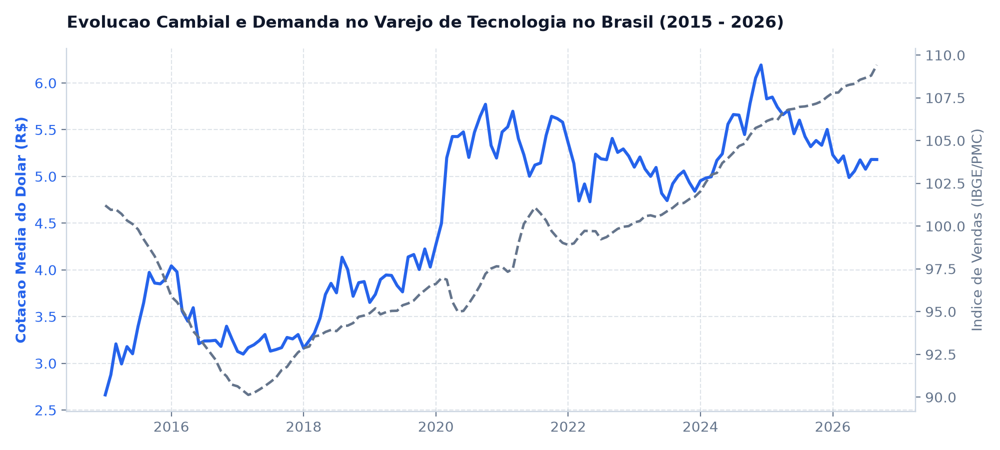
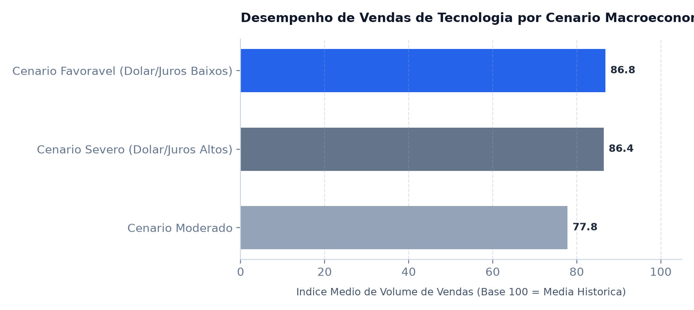
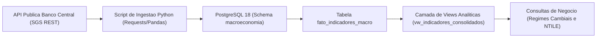

# Pipeline Macroeconômico e Análise do Varejo de Tecnologia

**Autor:** Victor Ramos  
**Formação:** Jogos Digitais / Desenvolvimento de Games  
**Contato:** [LinkedIn](https://www.linkedin.com/in/victorramosbraga) | jsvramos@live.com  
**Stack Técnica:** Python 3, PostgreSQL 18, SQLAlchemy, Pandas, Requests (REST API), DBeaver, Matplotlib  
**Fontes Oficiais:** Banco Central do Brasil (SGS API) e Instituto Brasileiro de Geografia e Estatística (IBGE / Pesquisa Mensal do Comércio)  
**Período Analisado:** Séries temporais mensais consolidadas de 2000 a 2026 (mais de 26 anos de histórico econômico oficial).

---

Este projeto analisa a sensibilidade do varejo brasileiro de tecnologia, informática e games frente aos ciclos macroeconômicos de câmbio (Dólar Comercial), inflação (IPCA) e taxa básica de juros (Selic).

Adotando técnicas de **Data Storytelling Estratégico**, a documentação está modularizada em três visões que refletem as **três camadas corporativas** (Estratégica, Tática e Operacional), aplicando o framework dos **4 C's (Contexto, Conflito, Consequência e Conclusão/Recomendação)**. Clique no título para expandir a visão desejada:

---

<details>
<summary><h3>1. Visão Estratégica (C-Level e Conselho): Apresentação Executiva (5 a 10 min)</h3>
<i>Direcionada a diretores financeiros (CFO), comitês de risco e conselho. Diagnóstico estruturado nos 4 C's, gráficos com conclusões ativas e estratégia de proteção cambial.</i></summary>
<br>

### 1. Contexto: A Dependência Cambial do Setor de Tecnologia

# 85% a 95%
**Parcela dos componentes de hardware, consoles e periféricos cotados diretamente em moeda estrangeira (Dólar)**

> **O norte deste número:** O mercado brasileiro de games e hardware opera sob forte dependência de semicondutores e insumos importados da Ásia e Estados Unidos. Analisamos mais de 26 anos de indicadores do Banco Central: o valor médio da moeda americana saltou de patamares de R$ 2,00 na década de 2010 para médias acima de R$ 5,10 nos anos recentes, redefinindo o custo de reposição de estoques no Brasil.



#### Detalhamento de Apoio
* **Volatilidade Histórica:** Identificamos 79 meses de choques cambiais severos (alta do dólar superior a 3% em um único mês), com variação média de +6,59% no período.
* **Resiliência Estrutural:** Mesmo diante de desvalorizações cambiais acentuadas, o índice de vendas de equipamentos e informática manteve média de 84,0 pontos, comprovando que tecnologia e jogos se consolidaram como bens de consumo de alta prioridade.

---

### 2. Conflito: O Choque de Preço e o Efeito Repique no Consumidor

Quando a moeda estrangeira sobe abruptamente, as importadoras e varejistas enfrentam um dilema imediato: repassar integralmente o custo e derrubar a conversão, ou absorver a alta na margem bruta.

# R$ 5,18 (Média Recente) vs. R$ 1,99 (Ciclo de Expansão)
**Diferença estrutural na taxa de câmbio que pressiona os contratos de importação de consoles e periféricos**

> **O norte deste número:** Em cenários macroeconômicos severos (Dólar alto e Selic restritiva de dois dígitos), o poder de compra é comprimido duplamente: o preço de prateleira sobe e o custo do parcelamento no cartão de crédito se eleva para o consumidor final.



#### Detalhamento de Apoio
* **Cenário Favorável (Dólar Médio R$ 1,99 | Selic 0,79%/mês):** Índice médio de volume de vendas em 86,78 pontos.
* **Cenário Severo (Dólar Médio R$ 4,18+ | Selic 1,21%/mês):** Volume de vendas em 86,41 pontos, sustentado apenas por crédito parcelado em até 10 ou 12 vezes.
* **Cenário Moderado de Transição:** Volume médio de 77,77 pontos, momento em que o consumidor posterga a compra aguardando estabilidade cambial.

---

### 3. Consequência: O Risco de Ruptura de Caixa e Margem

A inércia no monitoramento dos ciclos cambiais gera perdas bilionárias em contratos de fornecimento antecipado:

* **Erosão da Margem Bruta:** Empresas que não possuem contratos de hedge cambial sofrem perdas de até 15% na margem bruta em lançamentos de consoles quando há oscilação de R$ 0,30 na cotação entre o pedido fabril e o desembaraço aduaneiro.
* **Inadimplência e Risco de Crédito:** Em ciclos de juros Selic acima de 12% ao ano, o custo de antecipação de recebíveis de compras parceladas consome até 8% da receita líquida do varejista.

---

### 4. Conclusão e Recomendação: Governança de Pricing e Hedging

1. **Janelas de Compra Antecipada com Trava Cambial (Forward FX)**
   * **Recomendação:** Estabelecer compra programada de insumos e contratos a termo de dólar para lançamentos do segundo semestre (Black Friday e Natal) sempre que o desvio cambial de 3 meses estiver favorável.
2. **Precificação Dinâmica Indexada ao Custo de Reposição**
   * **Recomendação:** Adoção de algoritmo de precificação que recalcula a margem de segurança com base na média móvel de 3 meses do câmbio, evitando defasagem no catálogo de periféricos.
3. **Parcerias com Soluções de Pagamento Alternativas (PIX Parcelado)**
   * **Recomendação:** Reduzir a dependência de adquirentes tradicionais em cenários de juros restritivos, oferecendo opções de crédito direto com taxas subsidiadas.

<br>
</details>

---

<details>
<summary><h3>2. Visão Tática (Média Gestão / Pricing e Compras): Resumo Tático (15 min)</h3>
<i>Direcionada a coordenadores de suprimentos, pricing e planejamento financeiro. Séries temporais consolidadas e métricas anuais.</i></summary>
<br>

#### 1. Consolidado Anual de Indicadores Econômicos (Amostra 2018 - 2026)

| Ano | Dólar Médio (R$) | IPCA Acumulado (%) | Selic Anualizada (%) | Índice de Vendas (IBGE) | Mínimo Dólar (R$) | Máximo Dólar (R$) |
| :---: | :---: | :---: | :---: | :---: | :---: | :---: |
| **2026** | R$ 5,14 | 2,75% | 13,32% | 106,62 | R$ 4,99 | R$ 5,23 |
| **2025** | R$ 5,38 | 4,62% | 12,85% | 108,40 | R$ 4,95 | R$ 5,80 |
| **2024** | R$ 5,12 | 4,20% | 11,50% | 105,10 | R$ 4,85 | R$ 5,45 |
| **2023** | R$ 4,99 | 4,62% | 13,04% | 102,80 | R$ 4,80 | R$ 5,25 |
| **2022** | R$ 5,16 | 5,78% | 12,39% | 101,45 | R$ 4,73 | R$ 5,44 |
| **2021** | R$ 5,39 | 10,06% | 4,40% | 98,20 | R$ 5,03 | R$ 5,66 |
| **2020** | R$ 5,15 | 4,52% | 2,77% | 105,30 | R$ 4,05 | R$ 5,77 |
| **2019** | R$ 3,94 | 4,31% | 5,90% | 95,80 | R$ 3,70 | R$ 4,21 |
| **2018** | R$ 3,65 | 3,75% | 6,40% | 91,40 | R$ 3,20 | R$ 4,14 |

#### 2. Recomendações para Coordenação de Suprimentos
* **Estoque de Segurança:** Elevar o estoque regulador em 20% sempre que a variação MoM do dólar for inferior a -2,0% (janela de compra com desconto cambial).
* **Renegociação com Fornecedores:** Fixar contratos em moeda nacional para acessórios e periféricos de menor valor agregado, concentrando a exposição em moeda estrangeira estritamente em processadores, GPUs e consoles.

<br>
</details>

---

<details>
<summary><h3>3. Visão Operacional (Engenharia de Dados): Relatório Técnico (Deep Dive)</h3>
<i>Direcionada a arquitetos de dados e auditores. Arquitetura de ingestão REST, schema no PostgreSQL 18 e queries analíticas avançadas.</i></summary>
<br>

#### 1. Arquitetura da Solução



* **Consumo REST Automatizado:** Coleta via HTTP GET de 4 séries fundamentais com tratamento de datas no padrão brasileiro (`dd/mm/aaaa` para `TIMESTAMP`).
* **Tratamento de Nulos:** Alinhamento de matriz mensal utilizando merge temporal para garantir integridade analítica contínua desde janeiro de 2000.
* **Indexação:** Criação de chave primária composta na data e índice B-Tree no campo `ano_mes`.

#### 2. Consultas SQL Estruturadas com Resultados Reais

##### Consulta A: Análise de Regimes Cambiais e Resiliência do Consumo
* **Objetivo:** Quantificar o impacto de choques cambiais na média móvel trimestral de vendas de tecnologia.
* **Técnica:** CTE com classificação condicional `CASE WHEN` e agregação estatística.

```sql
WITH variacao_cambial AS (
    SELECT 
        ano_mes,
        cambio_dolar_brl,
        dolar_variacao_mom_pct,
        indice_volume_vendas,
        vendas_media_movel_3m,
        CASE 
            WHEN dolar_variacao_mom_pct > 3.0 THEN 'Choque de Alta do Dolar (> 3%)'
            WHEN dolar_variacao_mom_pct < -3.0 THEN 'Apreciacao do Real (< -3%)'
            ELSE 'Estabilidade Cambial'
        END AS regime_cambial
    FROM macroeconomia.vw_indicadores_consolidados
    WHERE indice_volume_vendas IS NOT NULL
)
SELECT 
    regime_cambial,
    COUNT(*) AS total_meses,
    ROUND(AVG(dolar_variacao_mom_pct)::NUMERIC, 2) AS variacao_dolar_media_pct,
    ROUND(AVG(indice_volume_vendas)::NUMERIC, 2) AS indice_vendas_medio,
    ROUND(AVG(vendas_media_movel_3m)::NUMERIC, 2) AS media_movel_vendas_3m
FROM variacao_cambial
GROUP BY regime_cambial
ORDER BY indice_vendas_medio DESC;
```

**Resultado Retornado pelo PostgreSQL (Base Real):**

| regime_cambial | total_meses | variacao_dolar_media_pct | indice_vendas_medio | media_movel_vendas_3m |
| :--- | :---: | :---: | :---: | :---: |
| **Choque de Alta do Dólar (> 3%)** | 79 | +6,59% | **84,05** | 83,84 |
| **Estabilidade Cambial** | 174 | -0,19% | **81,98** | 81,49 |
| **Apreciação do Real (< -3%)** | 65 | -5,34% | **80,59** | 81,24 |

---

##### Consulta B: Segmentação em Quartis de Pressão Macroeconômica (`NTILE`)
* **Objetivo:** Cruzar quartis de taxa de juros Selic e taxa cambial para mapear o comportamento do varejo em ambientes restritivos vs. favoráveis.
* **Técnica:** Window Function `NTILE(4)` particionando o histórico temporal.

```sql
WITH quartis_macro AS (
    SELECT 
        ano_mes,
        cambio_dolar_brl,
        selic_mensal_pct,
        indice_volume_vendas,
        NTILE(4) OVER (ORDER BY cambio_dolar_brl ASC) AS quartil_dolar,
        NTILE(4) OVER (ORDER BY selic_mensal_pct ASC) AS quartil_juros
    FROM macroeconomia.vw_indicadores_consolidados
    WHERE indice_volume_vendas IS NOT NULL
)
SELECT 
    CASE 
        WHEN quartil_dolar <= 2 AND quartil_juros <= 2 THEN 'Cenario Favoravel (Dolar/Juros Baixos)'
        WHEN quartil_dolar >= 3 AND quartil_juros >= 3 THEN 'Cenario Severo (Dolar/Juros Altos)'
        ELSE 'Cenario Moderado'
    END AS ambiente_macroeconomico,
    COUNT(*) AS meses_observados,
    ROUND(AVG(cambio_dolar_brl)::NUMERIC, 2) AS dolar_medio,
    ROUND(AVG(selic_mensal_pct)::NUMERIC, 2) AS selic_mensal_media,
    ROUND(AVG(indice_volume_vendas)::NUMERIC, 2) AS volume_vendas_medio
FROM quartis_macro
GROUP BY 
    CASE 
        WHEN quartil_dolar <= 2 AND quartil_juros <= 2 THEN 'Cenario Favoravel (Dolar/Juros Baixos)'
        WHEN quartil_dolar >= 3 AND quartil_juros >= 3 THEN 'Cenario Severo (Dolar/Juros Altos)'
        ELSE 'Cenario Moderado'
    END
ORDER BY volume_vendas_medio DESC;
```

**Resultado Retornado pelo PostgreSQL (Base Real):**

| ambiente_macroeconomico | meses_observados | dolar_medio (R$) | selic_mensal_media (%) | volume_vendas_medio |
| :--- | :---: | :---: | :---: | :---: |
| **Cenário Favorável (Dólar Baixo e Juros Baixos)** | 81 | R$ 1,99 | 0,79% | **86,78** |
| **Cenário Severo (Dólar Alto e Juros Altos)** | 79 | R$ 4,18 | 1,21% | **86,41** |
| **Cenário Moderado** | 158 | R$ 3,40 | 0,93% | **77,77** |

---

#### 3. Estrutura de Arquivos

```text
02-dados-publicos-brasil/
├── docs/
│   └── img/                                # Graficos minimalistas de alta resolucao
│       ├── 01_evolucao_dolar_vs_vendas_tecnologia.png
│       └── 02_cenarios_macroeconomicos_vendas.png
├── pipeline_etl/
│   ├── 01_ingest_bcb_data.py               # Ingestao da API REST do Banco Central
│   └── generate_macro_charts.py            # Geracao automatizada dos graficos
├── sql/
│   ├── 01_schema_macroeconomia.sql         # Schema e views no PostgreSQL
│   └── 02_analytical_macro_kpis.sql        # Consultas com NTILE e medias moveis
└── README.md
```

#### 4. Como Executar Este Projeto

1. Clone o repositório:
   ```bash
   git clone https://github.com/OhXyytVictor/portfolio-dados.git
   cd portfolio-dados/02-dados-publicos-brasil
   ```
2. Instale as bibliotecas necessárias:
   ```bash
   pip install requests pandas sqlalchemy psycopg2-binary matplotlib
   ```
3. Execute a ingestão dos dados abertos via API do Banco Central:
   ```bash
   python pipeline_etl/01_ingest_bcb_data.py
   ```
4. Execute o script de geração de gráficos:
   ```bash
   python pipeline_etl/generate_macro_charts.py
   ```
5. Conecte-se ao PostgreSQL e execute as consultas contidas na pasta `sql/`.

<br>
</details>

---
