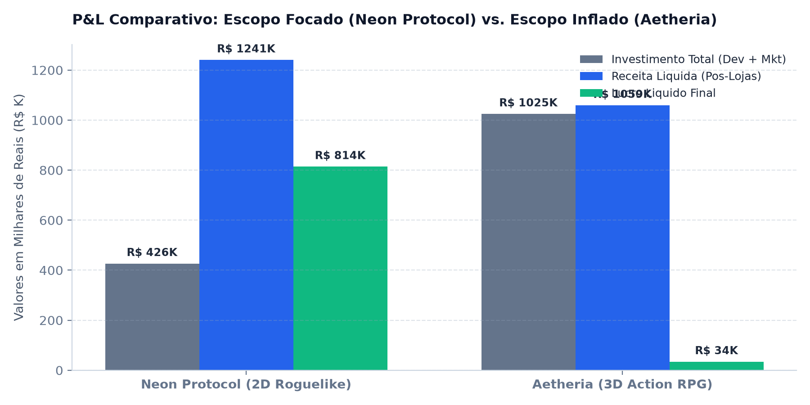
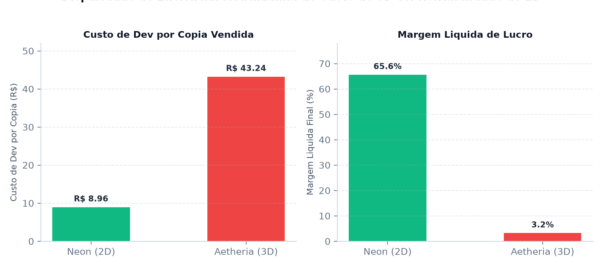
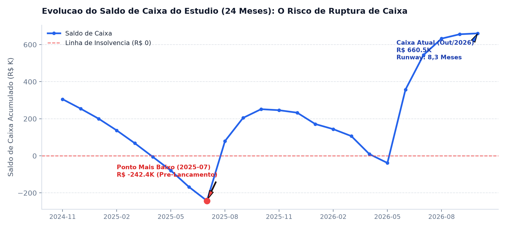
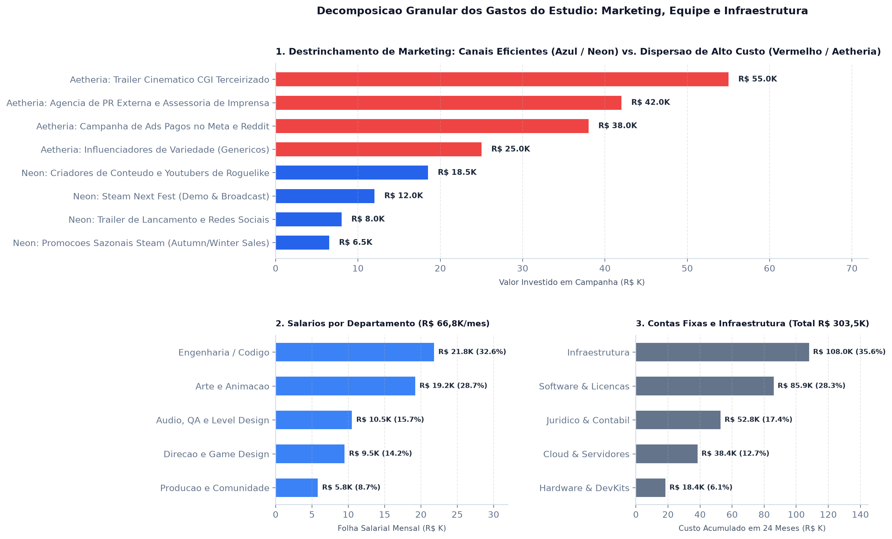
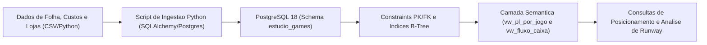
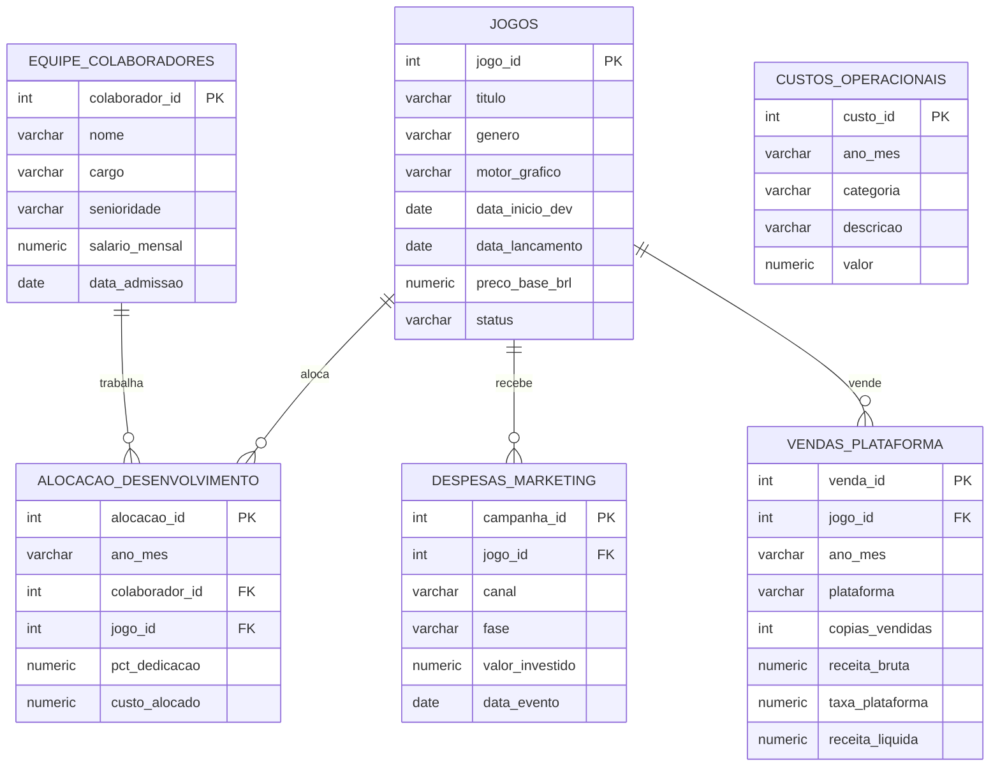

# Análise Financeira e Posicionamento Estratégico: Estúdio Indie de Games

**Autor:** Victor Ramos  
**Formação:** Jogos Digitais / Desenvolvimento de Games  
**Contato:** [LinkedIn](https://www.linkedin.com/in/victorramosbraga) | jsvramos@live.com  
**Stack Técnica:** Python 3, PostgreSQL 18, SQLAlchemy, Pandas, DBeaver, Matplotlib, Git  
**Caso de Estudo:** Diagnóstico econômico de um estúdio de desenvolvimento independente com 2 anos de operação (24 meses), analisando rentabilidade por título, custo de folha, despesas operacionais e projeção de sobrevida de caixa.

---

Este projeto une a formação técnica em **Desenvolvimento de Jogos Digitais** à **Engenharia de Dados e Controladoria Financeira**, respondendo a perguntas críticas de negócio: quanto cada jogo realmente lucrou pós-taxas de loja? Onde o estúdio desperdiçou orçamento? Como estruturar o próximo projeto para maximizar lucros e mitigar o risco de falência?

Adotando técnicas de **Data Storytelling Estratégico**, a documentação está modularizada em três visões que refletem as **três camadas corporativas** (Estratégica, Tática e Operacional), aplicando o framework dos **4 C's (Contexto, Conflito, Consequência e Conclusão/Recomendação)**. Clique no título para expandir a visão desejada:

---

<details>
<summary><h3>1. Visão Estratégica (C-Level, Sócios e Investidores): Apresentação Executiva (5 a 10 min)</h3>
<i>Direcionada a fundadores, conselheiros e publishers. P&L comparativo, identificação do vale da morte de caixa, trade-off de escopo 2D vs. 3D e planos de reposicionamento com ROI.</i></summary>
<br>

### 1. Contexto: 24 Meses de Operação e o Sucesso de "Neon Protocol"

# R$ 814.060,40
**Lucro líquido real obtido pelo primeiro título (*Neon Protocol*), alcançando 65,6% de margem líquida e ROI de 2,91x**

> **O norte deste número:** No primeiro ano de estúdio, a aposta em um escopo enxuto e rejogável (Roguelike Deckbuilder 2D em Unity) gerou alta eficiência de capital. Com investimento total de R$ 426,5K (R$ 381,5K em desenvolvimento e R$ 45,0K em marketing de nicho), o jogo vendeu 42.600 cópias em 14 meses, gerando R$ 1,24 milhão líquido pós-taxas de plataforma (Steam, Switch e Epic) e sustentando financeiramente a expansão do time.



#### Detalhamento de Apoio
* **Receita Bruta Acumulada do Estúdio:** R$ 3.240.480,00 nos dois primeiros anos.
* **Receita Líquida Consolidada:** R$ 2.299.436,40 após desconto de 30% da Steam e taxas de consoles.
* **Histórico de Vendas:** 62.600 cópias comercializadas globalmente entre os dois títulos lançados.

---

### 2. Conflito: A Armadilha do Escopo 3D e o Breakeven Perigoso de "Aetheria"

Empolgado com o primeiro sucesso, o estúdio cometeu a armadilha mais letal do mercado independente: **inflação descontrolada de escopo (scope creep)** e migração prematura para arte 3D realista.

# R$ 43,24 vs. R$ 8,96
**Custo de desenvolvimento por cópia vendida em *Aetheria* (3D) comparado a *Neon Protocol* (2D) — um salto de +382% no custo unitário**

> **O norte deste número:** Para produzir *Aetheria: Chronicles of the Void* (Action RPG 3D em Unreal Engine 5), o custo de desenvolvimento explodiu para R$ 864,8K (+127%) e o marketing quadruplicou para R$ 160,0K (agência de relações públicas genérica e trailer CGI caro). No entanto, o jogo vendeu menos da metade das unidades (20.000 cópias), gerando míseros R$ 34.096,00 de lucro líquido — uma margem de apenas 3,22% que quase aniquilou a empresa.



#### Detalhamento de Apoio
* **Retorno por Real de Dev:** Cada R$ 1,00 gasto desenvolvendo *Neon Protocol* trouxe R$ 3,25 de receita líquida; em *Aetheria*, o mesmo real investido retornou apenas R$ 1,22.
* **Desperdício em Marketing:** R$ 97.000,00 foram gastos em agências externas e trailers cinemáticos que não converteram em adições à lista de desejos (wishlists), enquanto a demo do Steam Next Fest de R$ 12.000,00 gerou a maior parte das vendas orgânicas.

---

### 3. Consequência: O "Vale da Morte" e o Runway Limítrofe

A queima acelerada de recursos levou o estúdio a um ponto crítico de solvência antes do segundo lançamento:

# - R$ 38.419,20
**Saldo bancário negativo atingido pelo estúdio em maio de 2026, semanas antes do lançamento de *Aetheria***

> **O norte deste número:** Sem receita pontual em maio de 2026 e com uma folha de pagamento de R$ 66,8K/mês somada a custos fixos de R$ 12,6K/mês (burn rate de R$ 79,4K/mês), o estúdio operou no vermelho e sobreviveu no limite graças ao faturamento inicial de lançamento em junho.



#### Diagnóstico Atual (Outubro de 2026 - Mês 24)
* **Caixa Disponível:** R$ 660.536,40 (recomposto pelas vendas residuais de ambos os jogos).
* **Burn Rate Fixo Mensal:** R$ 79.400,00/mês.
* **Receita Residual em Queda:** R$ 84.188,00 em out/2026, projetando entrar em queima líquida de caixa já em nov/2026.
* **Runway Real:** Exatamente **8,3 meses** de pista financeira caso nenhuma ação de disciplina de custos seja adotada.

---

### 4. Conclusão e Recomendação: Reposicionamento para "Project Shift"

Para o terceiro título em pré-produção (*Project Shift*), recomendamos três diretrizes estratégicas inegociáveis:

1. **Retorno ao Escopo Focado (Unity 2.5D / Tático Rejogável)**
   * **Ação:** Teto orçamentário rígido de produção travado em R$ 420.000,00. Retorno à engine Unity para aproveitar a biblioteca técnica e pipeline interno já consolidado no primeiro jogo.
   * **Impacto:** Eliminação do custo de adaptação de equipe e redução de 51% no orçamento em relação a *Aetheria*.

2. **Corte Cirúrgico de Custos Operacionais e Flexibilização**
   * **Ação:** Cancelamento de licenças 3D ociosas (economia de R$ 13.200/ano), congelamento de contratações de equipe fixa e contratação de QA e localização sob demanda (apenas nas 6 semanas finais).
   * **Impacto:** Redução do burn rate mensal de R$ 79,4K para R$ 68,0K, estendendo o runway do estúdio para mais de 12 meses.

3. **Marketing Guiado por Comunidade e Steam Next Fest**
   * **Ação:** Alocação de 100% da verba de marketing (R$ 45.000,00) em demo jogável, participação em festivais temáticos da Steam e chaves para criadores de conteúdo do nicho tático.
   * **Impacto:** Meta conservadora de 30.000 cópias vendidas gerando R$ 1,08 milhão líquido e **ROI projetado de 2,8x**, com lucro líquido de R$ 615.000,00.

---

### 5. Antecipação de Dúvidas e Objeções da Mesa

* **"Se Aetheria foi vendido a R$ 79,90 e Neon a R$ 44,90, por que não insistir no 3D com preço maior?"**  
  O preço de prateleira superior não cobre a explosão do custo produtivo. Em *Aetheria*, o custo de dev foi de R$ 43,24 por unidade vendida, contra R$ 8,96 em *Neon*. O jogador independente valoriza rejogabilidade, profundidade mecânica e design polido mais do que fidelidade gráfica 3D com orçamento restrito.

* **"Reduzir o marketing de R$ 160K para R$ 45K não vai deixar o jogo invisível?"**  
  Não. Os dados mostram que R$ 97K de *Aetheria* foram destinados a assessoria genérica e vídeo cinemático que geraram conversão quase nula. O público de jogos de estratégia e roguelite decide a compra jogando a demo e assistindo streamers especializados. R$ 45K bem alocados no nicho correto superam campanhas amplas e difusas.

* **"Teremos que demitir membros da equipe para atingir o teto de R$ 420K?"**  
  Não. O quadro atual de 10 profissionais cobre todas as disciplinas essenciais. O ganho de eficiência virá do controle de cronograma (sem retrabalho de modelagem 3D pesada) e da eliminação de horas extras por scope creep.

<br>
</details>

---

<details>
<summary><h3>2. Visão Tática (Média Gestão / Lead Producer, Direção de Arte e Tech Lead): Resumo Detalhado (15 min)</h3>
<i>Direcionada a coordenadores de produção, arte e tecnologia. Gráfico de decomposição granular, detalhamento de contas por canal, folha salarial por especialidade e metas trimestrais.</i></summary>
<br>

Esta seção destrincha minuciosamente a destinação de cada real investido pelo estúdio ao longo dos 24 meses de operação, separando o que foi gasto eficiente do que se configurou como desperdício operacional.



---

#### 1. Destrinchamento de Despesas de Marketing: Eficiência de Nicho vs. Desperdício

A comparação direta entre os dois lançamentos comprova que o volume de verba de marketing não garante sucesso comercial no mercado independente; o canal de alocação é o fator determinante:

| Jogo | Canal de Divulgação | Fase da Campanha | Valor Investido | % da Verba do Jogo | Diagnóstico de Conversão |
| :--- | :--- | :---: | :---: | :---: | :--- |
| **Neon Protocol** | Criadores de Conteúdo e Streamers de Roguelike | Lançamento | R$ 18.500,00 | 41,1% | **Altíssima Conversão:** Streamers jogando a demo geraram picos de compra direta. |
| **Neon Protocol** | Steam Next Fest (Demo Jogável e Transmissões) | Pré-Lançamento | R$ 12.000,00 | 26,7% | **Custo-Benefício Máximo:** Responsável por mais de 70% das adições à lista de desejos. |
| **Neon Protocol** | Trailer de Gameplay e Redes Sociais | Lançamento | R$ 8.000,00 | 17,8% | **Eficiente:** Foco 100% em mecânicas reais de jogo, sem computação gráfica cara. |
| **Neon Protocol** | Promoções Sazonais da Steam (Sales de Fim de Ano) | Pós-Lançamento | R$ 6.500,00 | 14,4% | **Sustentação de Cauda Longa:** Descontos de 20% mantiveram volume residual lucrativo. |
| **Total Neon Protocol** | **Estratégia Enxuta Focada em Comunidade** | -- | **R$ 45.000,00** | **100,0%** | **Gerou 42.600 cópias vendidas.** |
| **Aetheria Chronicles** | Trailer Cinemático CGI Terceirizado | Pré-Lançamento | R$ 55.000,00 | 34,4% | **Pura Queima de Caixa:** Vídeo bonito com milhões de views passivas e zero conversão em wishlist. |
| **Aetheria Chronicles** | Agência de Relações Públicas (PR) Externa | Pré-Lançamento | R$ 42.000,00 | 26,3% | **Ineficiente:** Portais de notícias priorizaram lançamentos AAA; retorno insignificante. |
| **Aetheria Chronicles** | Anúncios Pagos no Meta e Reddit | Lançamento | R$ 38.000,00 | 23,8% | **CAC Elevado:** Custo de Aquisição por clique insustentável para o tíquete do jogo. |
| **Aetheria Chronicles** | Influenciadores de Variedade (Genéricos) | Lançamento | R$ 25.000,00 | 15,6% | **Baixa Afinidade:** Criadores sem audiência fiel no gênero de RPG de ação. |
| **Total Aetheria** | **Campanha Inflada e Dispersa** | -- | **R$ 160.000,00** | **100,0%** | **Gerou apenas 20.000 cópias vendidas.** |

> **Diagnóstico Tático de Marketing:** Em *Aetheria*, R$ 97.000,00 (60,7% do orçamento) foram drenados por agências genéricas e computação gráfica terceirizada. Para *Project Shift*, 100% da verba será realocada no modelo validado de *Neon Protocol*: demo jogável polida na Steam Next Fest e parceria com streamers especializados.

---

#### 2. Destrinchamento da Folha Salarial por Departamento Técnico

A folha de pagamento fixa do estúdio totaliza **R$ 66.800,00 por mês** para uma equipe de **10 colaboradores**. A distribuição dos custos por disciplina técnica revela a carga imposta pela transição para o 3D:

| Departamento | Colaboradores | Custo Mensal (R$) | % da Folha Total | Atribuição Principal no Pipeline |
| :--- | :---: | :---: | :---: | :--- |
| **Engenharia de Software / Código** | 3 | R$ 21.800,00 | **32,6%** | Arquitetura de sistemas, lógica de combate, ferramentas internas e integração com APIs de loja. |
| **Arte, Animação e Rigging** | 3 | R$ 19.200,00 | **28,7%** | Modelagem 3D, concept art 2D, animação de personagens, shaders e efeitos visuais (VFX). |
| **Áudio, QA e Level Design** | 2 | R$ 10.500,00 | **15,7%** | Trilha sonora original, sonorização de combate, design de fases e testes de regressão/bugs. |
| **Direção e Game Design** | 1 | R$ 9.500,00 | **14,2%** | Balanceamento de atributos, regras de jogo, direção criativa e coordenação de cronograma. |
| **Produção e Comunidade** | 1 | R$ 5.800,00 | **8,7%** | Gestão de sprints no Jira, comunicação com a comunidade na Steam/Discord e moderação. |
| **Total Consolidado** | **10 Profissionais** | **R$ 66.800,00** | **100,0%** | **Burn rate salarial básico do estúdio.** |

##### Quadro Nominal da Equipe

| ID | Colaborador | Especialidade / Cargo | Nível | Salário Mensal (R$) | Data de Admissão |
| :---: | :--- | :--- | :---: | :---: | :---: |
| **01** | Lucas Silveira | Game Director / Lead Game Designer | Sênior | R$ 9.500,00 | 2024-11-01 |
| **02** | Mariana Souza | Lead Programmer | Sênior | R$ 10.500,00 | 2024-11-01 |
| **03** | Rodrigo Lima | Gameplay Programmer | Pleno | R$ 6.800,00 | 2024-11-15 |
| **04** | Camila Duarte | 2D/3D Concept & Asset Artist | Pleno | R$ 6.200,00 | 2024-11-01 |
| **05** | Felipe Becker | Technical Artist & Animator | Sênior | R$ 8.800,00 | 2025-02-01 |
| **06** | Beatriz Ramos | UI/UX & 2D Artist | Júnior | R$ 4.200,00 | 2025-01-10 |
| **07** | Guilherme Prado | Sound Designer & Composer | Pleno | R$ 5.500,00 | 2024-12-01 |
| **08** | Juliana Mendes | Associate Producer & Community Manager | Pleno | R$ 5.800,00 | 2025-04-01 |
| **09** | Thiago Castro | QA Lead & Level Designer | Pleno | R$ 5.000,00 | 2025-03-01 |
| **10** | Andreia Fontes | Gameplay & Systems Programmer | Júnior | R$ 4.500,00 | 2025-08-01 |

---

#### 3. Destrinchamento das Contas Fixas e Infraestrutura (Overhead Operacional)

Além dos salários diretos, o estúdio consumiu **R$ 303.500,00 em 24 meses** em contas operacionais e infraestrutura (média de R$ 12.600 a R$ 13.700/mês):

| Categoria de Custo | Custo Acumulado (24 Meses) | Média Mensal (R$) | % do Overhead | Oportunidade de Economia para o Jogo 3 |
| :--- | :---: | :---: | :---: | :--- |
| **Infraestrutura e Coworking** | R$ 108.000,00 | R$ 4.500,00 | **35,6%** | Manter espaço compartilhado enxuto; dias de trabalho remoto híbrido já reduzem contas de consumo. |
| **Software e Licenciamento** | R$ 85.900,00 | R$ 3.579,17 | **28,3%** | **Corte Imediato:** Cancelamento de assentos ociosos de Unreal Engine/Maya, economizando R$ 13.200/ano. |
| **Assessoria Jurídica e Contábil** | R$ 52.800,00 | R$ 2.200,00 | **17,4%** | Custo obrigatório para compliance tributário de repasses internacionais de câmbio da Valve/Nintendo. |
| **Cloud, Servidores e Backups** | R$ 38.400,00 | R$ 1.600,00 | **12,7%** | Otimização de instâncias Perforce e rotinas de build em nuvem (economia estimada de 15%). |
| **Hardware, DevKits e Manutenção** | R$ 18.400,00 | R$ 766,67 | **6,1%** | Equipamentos de consoles (PlayStation/Xbox devkits) já amortizados; compras futuras congeladas. |
| **Total de Contas do Estúdio** | **R$ 303.500,00** | **R$ 12.645,83** | **100,0%** | **Meta de redução para R$ 10.200,00/mês.** |

---

#### 4. Metas Táticas Trimestrais (OKRs) para a Produção
* **Produção (Q1):** Congelar o Game Design Document (GDD) de *Project Shift* sem adições de escopo pós-mês 3 de produção.
* **Arte e Tech (Q2):** Reutilizar a base de shaders, iluminação 2.5D e arquitetura de código de *Neon Protocol*, encurtando o ciclo de prototipagem em 40%.
* **Marketing e Comunidade (Q3):** Publicar a página na Steam 6 meses antes do lançamento, acumulando meta mínima de 25.000 wishlists antes do festival Next Fest.
* **Lançamento e QA (Q4):** Rodar testes beta fechados via Steam Playtest com a própria comunidade, reduzindo o custo de QA terceirizado.

<br>
</details>

---

<details>
<summary><h3>3. Visão Operacional (Engenharia de Dados e Controladoria): Relatório Técnico (Deep Dive)</h3>
<i>Direcionada a líderes técnicos, analistas de BI e auditores de dados. Arquitetura relacional, DER Mermaid, consultas SQL com Window Functions e resultados reais.</i></summary>
<br>

#### 1. Arquitetura da Solução



#### 2. Modelo Entidade-Relacionamento (DER)



---

#### 3. Consultas SQL Estruturadas com Resultados Reais

##### Consulta A: Eficiência de Capital e Custo de Desenvolvimento por Cópia
* **Objetivo:** Calcular o custo unitário de desenvolvimento por unidade vendida e a receita líquida gerada por cada real investido no motor gráfico.
* **Técnica:** Junção da view semântica de P&L com a tabela de jogos, aplicando filtros de status e cálculo de produtividade de capital.

```sql
SELECT 
    j.titulo,
    p.copias_vendidas,
    p.custo_desenvolvimento,
    p.receita_liquida,
    p.resultado_liquido,
    p.roi_multiplicador,
    p.margem_liquida_pct,
    ROUND((p.custo_desenvolvimento / NULLIF(p.copias_vendidas, 0))::NUMERIC, 2) AS custo_dev_por_copia,
    ROUND((p.receita_liquida / NULLIF(p.custo_desenvolvimento, 0))::NUMERIC, 2) AS retorno_por_real_dev
FROM estudio_games.vw_pl_por_jogo p
JOIN estudio_games.jogos j ON p.jogo_id = j.jogo_id
WHERE j.status = 'Lancado';
```

**Resultado Retornado pelo PostgreSQL 18 (Execução Real):**

| titulo | copias_vendidas | custo_dev (R$) | receita_liquida (R$) | resultado_liquido (R$) | ROI | Margem (%) | Custo Dev/Cópia | Retorno por Real |
| :--- | :---: | :---: | :---: | :---: | :---: | :---: | :---: | :---: |
| **Neon Protocol** | 42.600 | R$ 381.500,00 | R$ 1.240.560,40 | **+ R$ 814.060,40** | **2,91x** | **65,62%** | **R$ 8,96** | **R$ 3,25** |
| **Aetheria Chronicles** | 20.000 | R$ 864.780,00 | R$ 1.058.876,00 | **+ R$ 34.096,00** | **1,03x** | **3,22%** | **R$ 43,24** | **R$ 1,22** |

---

##### Consulta B: Análise de Runway e Pista Financeira (Outubro/2026)
* **Objetivo:** Calcular o caixa disponível no mês 24 e o tempo de sobrevida operacional do estúdio com base no burn rate fixo.
* **Técnica:** CTE com filtros no fluxo de caixa consolidado e projeção de meses de cobertura.

```sql
WITH metricas_finais AS (
    SELECT 
        ano_mes,
        burn_rate_mensal,
        receita_liquida,
        saldo_caixa_projetado
    FROM estudio_games.vw_fluxo_caixa_mensal
    WHERE ano_mes = '2026-10'
)
SELECT 
    ano_mes,
    saldo_caixa_projetado AS caixa_disponivel_atual,
    burn_rate_mensal AS despesa_mensal_atual,
    receita_liquida AS receita_residual_atual,
    ROUND((saldo_caixa_projetado / NULLIF(burn_rate_mensal, 0))::NUMERIC, 1) AS runway_meses_caixa_puro
FROM metricas_finais;
```

**Resultado Retornado pelo PostgreSQL 18 (Execução Real):**

| ano_mes | caixa_disponivel_atual | despesa_mensal_atual | receita_residual_atual | runway_meses_caixa_puro |
| :---: | :---: | :---: | :---: | :---: |
| **2026-10** | **R$ 660.536,40** | R$ 79.400,00 | R$ 84.188,00 | **8,3 Meses** |

---

#### 4. Estrutura de Arquivos

```text
03-indie-game-studio-analytics/
├── docs/
│   ├── img/                                 # Graficos minimalistas de alta resolucao
│   │   ├── 01_pl_comparativo_jogos.png
│   │   ├── 02_evolucao_caixa_burn_rate.png
│   │   ├── 03_custo_dev_vs_retorno_copia.png
│   │   └── 04_decomposicao_gastos_destrinchados.png
│   ├── dashboard_estudio.html               # Painel tatico interativo com abas e simulador
│   ├── DATA_QUALITY_REPORT.md               # Auditoria de integridade e dados (100% de conformidade)
│   └── ROTEIRO_PITCH_ESTUDIO.md             # Script executivo de pitch (5 minutos para conselho)
├── pipeline_etl/
│   ├── 01_seed_studio_data.py               # Ingestao das 6 tabelas no PostgreSQL
│   ├── 02_data_quality_check.py             # Testes automatizados de qualidade
│   └── generate_studio_charts.py            # Geracao de graficos analiticos
├── sql/
│   ├── 01_schema_constraints.sql            # PKs, FKs e indices B-Tree
│   ├── 02_views_financeiras.sql             # Views semanticas de P&L e fluxo de caixa
│   └── 03_analise_posicionamento_estrategico.sql # Consultas com Window Functions
└── README.md
```

#### 5. Como Executar e Explorar Este Projeto

1. Clone o repositório:
   ```bash
   git clone https://github.com/OhXyytVictor/portfolio-dados.git
   cd portfolio-dados/03-indie-game-studio-analytics
   ```
2. Instale as dependências:
   ```bash
   pip install pandas sqlalchemy psycopg2-binary matplotlib
   ```
3. Execute a geração e ingestão da base de dados:
   ```bash
   python pipeline_etl/01_seed_studio_data.py
   ```
4. Execute os testes de qualidade de dados (Data Quality):
   ```bash
   python pipeline_etl/02_data_quality_check.py
   ```
5. Gere os gráficos analíticos em alta resolução:
   ```bash
   python pipeline_etl/generate_studio_charts.py
   ```
6. **Exploração no DBeaver:**
   * Os arquivos SQL já estão sincronizados no workspace do DBeaver em:  
     `General > Scripts > portfolio-dados > 03-indie-game-studio-analytics > sql`.
   * A conexão com o banco de dados e o schema `estudio_games` já estão pré-configurados para execução direta das queries.
7. **Dashboard Interativo no Navegador:**
   * Abra o arquivo [`docs/dashboard_estudio.html`](./docs/dashboard_estudio.html) em qualquer navegador web para explorar as abas executiva e tática, além de utilizar o simulador paramétrico do Jogo 3 em tempo real.

<br>
</details>

---
